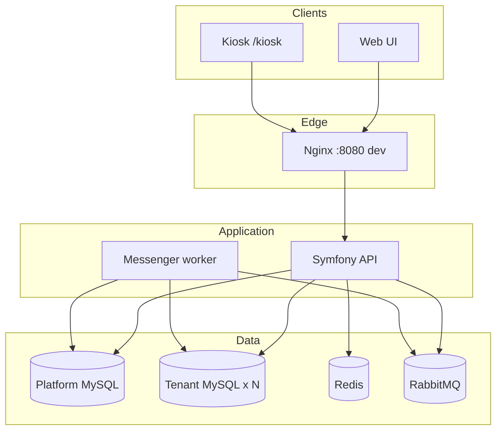

# Attendance

Multi-tenant employee attendance SaaS. Organizations (tenants) manage employees and attendance on their own hostname; platform operators manage tenants on the platform host. The repository contains the Symfony API, React client, Docker services, and **one MySQL database per tenant**.

## Project overview

**Purpose:** Record and review employee attendance (clock-in/out, lunch) with server-validated transitions, optional terminal kiosk flow, and tenant-specific branding and timezone display.

**Main use cases:**

- Platform operators provision and govern tenants and quotas
- Tenant admins configure branding, users, and terminals
- HR and managers review attendance and corrections
- Employees view history and request corrections
- Kiosks identify employees and commit attendance events

### Technology stack (actual)

| Layer | Technology |
| --- | --- |
| API | Symfony 7.4, PHP 8.4, Doctrine |
| UI | React, Vite, Redux Toolkit, React Router, i18next |
| Data | MySQL 8.4 (platform + per-tenant), Redis (sessions), RabbitMQ (Messenger) |
| Edge | Nginx → PHP-FPM and Vite (dev) or static assets (prod) |
| Runtime | Docker Compose (`docker-compose.yml` / `docker-compose.prod.yml`) |

### Architecture overview



Platform host (`PLATFORM_HOSTNAME`, `localhost` in development) never opens a tenant database for normal UI. Tenant hosts resolve via `Host` → `tenant_domains`. Deep design: [docs/architecture/system-overview.md](docs/architecture/system-overview.md), [docs/architecture.md](docs/architecture.md).

## Features and implementation status

| Feature | Status |
| --- | --- |
| Multi-tenant architecture; DB per tenant | **Implemented** |
| Super Admin tenant management | **Implemented** (UI + CLI + API) |
| User / employee management | **Implemented** |
| Quotas (users, employees, active devices) | **Implemented** |
| Employee code identification | **Implemented** (hashed at rest) |
| Fingerprint verification | **Partial** — mock in development; **unavailable** in production until a vendor adapter exists |
| Photograph capture | **Implemented** (local private storage; S3 adapter not shipped) |
| Clock-in / out, lunch start / end | **Implemented** (server clock, append-only ledger) |
| Attendance history and reports | **Implemented** (no CSV/PDF export UI) |
| Chief/Manager workflows | **Implemented** (assigned scope) |
| HR workflows | **Implemented** |
| Physical terminal management | **Implemented** (Ed25519 device auth + kiosk) |
| Tenant logo and colors | **Implemented** |
| Multiple languages | **Implemented** (`en`, `sv`) |
| UTC storage + IANA display | **Implemented** |
| Database Explorer + read-only SQL console | **Implemented** (needs read-only explorer URLs; else 503) |
| Docker local + prod Compose | **Implemented** |
| GitHub Actions CI | **Implemented** |
| GHCR image publish / CD deploy | **Designed** — activate per [docs/ci-cd-deployment.md](docs/ci-cd-deployment.md); may require pushing workflows and host config |
| Platform audit **UI** | **Not implemented** (API exists) |
| Email invitations / billing plans | **Not implemented** |
| Production fingerprint vendor | **Not connected** |

## Quick start

Complete install-from-scratch: **[docs/installation/local-development.md](docs/installation/local-development.md)**  
Prerequisites: [docs/installation/prerequisites.md](docs/installation/prerequisites.md)

Shortest path on a machine with Docker Compose v2:

```sh
cp .env.example .env
docker compose up --build -d
```

Wait until `nginx` is healthy (`docker compose ps`), then:

```sh
docker compose exec php php bin/console doctrine:migrations:migrate --no-interaction
docker compose exec php php bin/console app:tenant:provision acme "Acme AB" acme.localhost Europe/Stockholm --locale=en
docker compose exec php php bin/console app:platform:create-admin ops@example.com "Ops" --password='choose-a-long-password'
docker compose exec php php bin/console app:tenant:create-user acme ada@acme.example "Ada" --password='choose-a-long-password' --role=tenant_admin
```

- App: http://localhost:8080  
- Tenant: http://acme.localhost:8080  
- Liveness: http://localhost:8080/api/v1/health  

There are **no default passwords** in git. Passwords must be at least **12 characters**. Tenant users need at least one `--role`.

## Documentation map

### Installation

| Document | Contents |
| --- | --- |
| [docs/installation/prerequisites.md](docs/installation/prerequisites.md) | Docker, versions, ports |
| [docs/installation/local-development.md](docs/installation/local-development.md) | Install from scratch |
| [docs/installation/environment-configuration.md](docs/installation/environment-configuration.md) | Env vars |
| [docs/installation/database-setup.md](docs/installation/database-setup.md) | Platform + tenant DBs |
| [docs/installation/troubleshooting.md](docs/installation/troubleshooting.md) | Common failures |

### Architecture

| Document | Contents |
| --- | --- |
| [docs/architecture/system-overview.md](docs/architecture/system-overview.md) | Components |
| [docs/architecture/multi-tenancy.md](docs/architecture/multi-tenancy.md) | Isolation model |
| [docs/architecture/authentication-and-permissions.md](docs/architecture/authentication-and-permissions.md) | Sessions, roles |
| [docs/architecture/attendance-workflow.md](docs/architecture/attendance-workflow.md) | State machine |
| [docs/architecture/devices-and-hardware.md](docs/architecture/devices-and-hardware.md) | Terminals, mocks |
| [docs/architecture/timezone-and-localization.md](docs/architecture/timezone-and-localization.md) | UTC / i18n |
| [docs/architecture.md](docs/architecture.md) | Deep design log |
| [docs/README.md](docs/README.md) | Full product developer map |

### User guides

| Document | Audience |
| --- | --- |
| [docs/user-guide/super-admin.md](docs/user-guide/super-admin.md) | Platform admin |
| [docs/user-guide/tenant-administrator.md](docs/user-guide/tenant-administrator.md) | Tenant admin |
| [docs/user-guide/employee.md](docs/user-guide/employee.md) | Employee |
| [docs/user-guide/chief-manager.md](docs/user-guide/chief-manager.md) | Manager |
| [docs/user-guide/hr.md](docs/user-guide/hr.md) | HR |
| [docs/user-guide/attendance-terminal.md](docs/user-guide/attendance-terminal.md) | Kiosk |
| [docs/user-guide/database-explorer.md](docs/user-guide/database-explorer.md) | Explorer |

### Development and deployment

| Document | Contents |
| --- | --- |
| [docs/development/testing.md](docs/development/testing.md) | Test commands |
| [docs/development/coding-conventions.md](docs/development/coding-conventions.md) | Repo conventions |
| [docs/development/github-and-ci-cd.md](docs/development/github-and-ci-cd.md) | GitHub Actions |
| [docs/deployment/production-deployment.md](docs/deployment/production-deployment.md) | Production |
| [docs/deployment/migrations-and-backups.md](docs/deployment/migrations-and-backups.md) | Migrations / backups |
| [docs/deployment.md](docs/deployment.md) | Staging/prod ops reference |
| [docs/ci-cd-deployment.md](docs/ci-cd-deployment.md) | CD secrets and gates |

## Tests

```sh
docker compose exec php sh -c 'test -f .env || cp .env.test .env'
docker compose exec php php vendor/bin/phpunit
docker compose exec php php vendor/bin/phpstan analyse --memory-limit=512M
docker compose exec frontend npm test
docker compose exec frontend npm run lint
docker compose exec frontend npx tsc -b --pretty false
```

## Support and common problems

Start with **[docs/installation/troubleshooting.md](docs/installation/troubleshooting.md)**.  
Also: [docs/development.md](docs/development.md) (day-to-day diagnostics), [docs/tenant-databases.md](docs/tenant-databases.md).

## Security notes for contributors

Do not commit secrets, TLS private keys, database dumps, attendance photographs, or biometric material. If a secret appears in Git history, rotate it and stop before publishing further.
