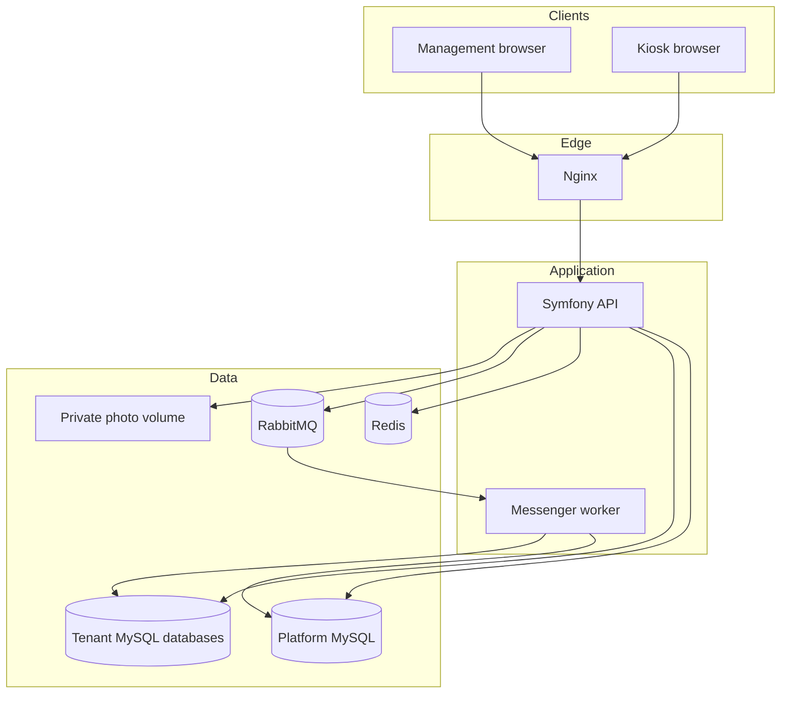
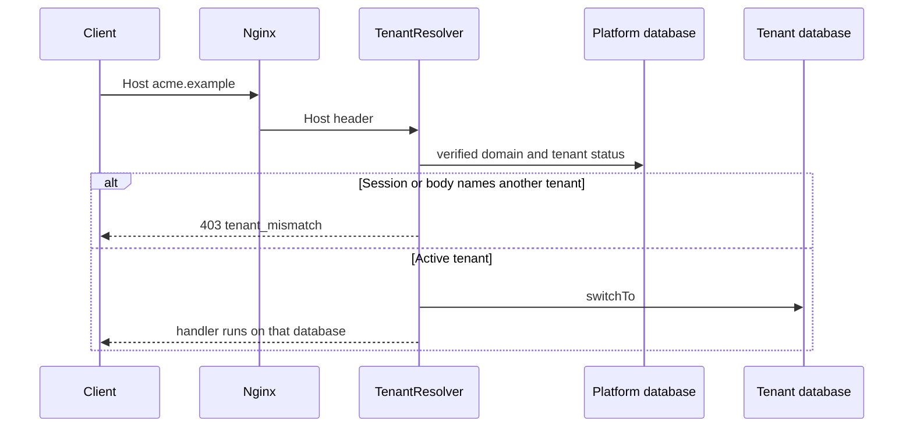
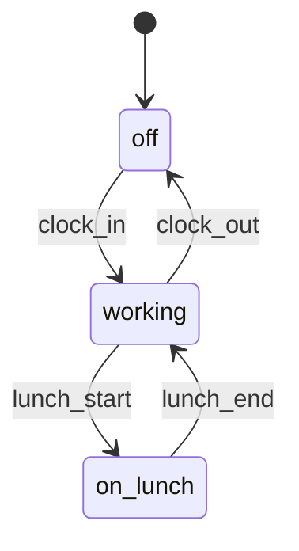

# Developer guide

This is the map of the attendance platform for a new senior developer. It describes what the repository implements today. Operational commands live in the linked documents. Conversation history is not part of the design.

The application is a multi-tenant SaaS for employee attendance. Each customer organization is a tenant with its own MySQL database. People sign in through a browser. Employees record attendance on a terminal kiosk: attendance code, fingerprint check, photograph, then clock in, lunch, or clock out. The server stores the fact in UTC and shows it in the tenant's IANA timezone.

| Read next | When |
| --- | --- |
| [installation/local-development.md](installation/local-development.md) | Install from scratch on a clean machine |
| [installation/prerequisites.md](installation/prerequisites.md) | Docker and version prerequisites |
| [installation/environment-configuration.md](installation/environment-configuration.md) | Environment variables |
| [installation/database-setup.md](installation/database-setup.md) | Platform and tenant databases |
| [installation/troubleshooting.md](installation/troubleshooting.md) | Common failures |
| [architecture/system-overview.md](architecture/system-overview.md) | Component diagram |
| [user-guide/super-admin.md](user-guide/super-admin.md) | Role-based operator guides (see `user-guide/`) |
| [development/testing.md](development/testing.md) | How to run tests |
| [development/github-and-ci-cd.md](development/github-and-ci-cd.md) | GitHub Actions and CD |
| [deployment/production-deployment.md](deployment/production-deployment.md) | Production summary |
| [development-setup.md](development-setup.md) | Shorter setup checklist (legacy entry) |
| [ci.md](ci.md) | CI job details |
| [ci-cd-deployment.md](ci-cd-deployment.md) | CD secrets/vars and gates |
| [development.md](development.md) | Day-to-day diagnostics |
| [tenant-databases.md](tenant-databases.md) | Provision, migrate, suspend, or drop a tenant |
| [architecture.md](architecture.md) | Table-level design and decision log |
| [terminal-hardware.md](terminal-hardware.md) | Add a fingerprint or camera adapter |
| [media-storage.md](media-storage.md) | Photograph storage rules |
| [domain-events.md](domain-events.md) | Event names and delivery |
| [testing.md](testing.md) | What each critical scenario asserts |
| [deployment.md](deployment.md) | Staging, production, backups, and rollback |

## 1. Product overview

Two clients share one API:

- The management application at `/me`, `/team`, `/hr`, `/settings`, and `/platform`. What a person sees follows permissions returned by the server.
- The kiosk at `/kiosk`. It identifies an employee, checks a fingerprint through a hardware port, captures a photograph, and commits one attendance action.

A platform operator creates tenants. A tenant administrator configures branding, languages, timezone, users, and terminals. HR manages the directory and tenant-wide attendance. A manager, which is the chief, sees assigned employees. An employee sees their own attendance and can request a correction.

Clock-in requires a photograph unless the tenant later turns that requirement off. Lunch start, lunch end, and clock-out do not require one. The terminal cannot invent an attendance time. The server clock is stored.

Unfinished on purpose:

- No production fingerprint vendor is connected. Production reports the reader as unavailable.
- No camera SDK is opened by the API. The kiosk sends the image.
- Email integration writes an outbox row. It does not send mail.
- Photograph bytes stay on a private volume. An S3-compatible store is not implemented.
- There is no platform-operator screen for `platform_audit_log`.

## 2. System architecture

The runtime is a modular monolith. Symfony 7.4 and PHP 8.4 serve the API through PHP-FPM. React 19, Vite, React Router, and Redux Toolkit serve the browser. Nginx routes `/api/` to PHP and everything else to the UI. MySQL holds the platform database and every tenant database. Redis holds sessions, device nonces, and authentication failure counters. RabbitMQ carries domain events to one Messenger consumer.

Backend code lives in `backend/src`. Tenant connection changes go through `TenantContext`. Attendance, directory, identity, devices, media, and integrations do not open a second tenant connection of their own. The React app lives in `frontend/src`. Features own their screens and RTK Query endpoints. `shared/api/deviceClient.ts` is the only place that attaches a device signature. `shared/theme` writes CSS variables. `shared/i18n` loads catalogs.

HTTP requests are short-lived PHP-FPM workers. The tenant connection is closed at the end of the request. The Messenger process is long-lived and clears that connection around every message.

## 3. Multi-tenant architecture

Tenants share the deployment and the platform database. They do not share business tables. A request is bound to one tenant for its whole life. The server chooses that tenant from the `Host` header, from the server session, or from an authenticated device. A browser or terminal cannot choose a tenant by sending an id.

`TenantAwareConnection` refuses SQL until `switchTo` selects an active tenant. `switchForMaintenance` is the provisioning and migration path. `reset` closes the connection and clears the in-memory context. Readiness fails if a tenant is already selected, because that check runs with no tenant.

SQLite is used only by automated tests, one file per tenant. Production refuses the SQLite driver.

## 4. Central database vs tenant database

The platform database answers who the tenant is and how to reach its database. It does not store employees, attendance events, attendance codes, or photographs.

| Platform table | Holds |
| --- | --- |
| `tenants` | Id, slug, legal name, status |
| `tenant_domains` | Verified hostname |
| `tenant_database_connections` | Host, database name, username, encrypted password |
| `tenant_branding`, `tenant_locales`, `tenant_settings` | Presentation and attendance photo policy |
| `tenant_integrations` | Encrypted integration configuration |
| `platform_users`, `platform_credentials`, `platform_memberships` | Platform operators |
| `device_registry`, `device_keys`, `device_enrollment_tokens` | Device identity and public keys |
| `tenant_device_policies` | Optional observed-IP and reported-network rules |
| `platform_audit_log` | Registry and operator audit |

The tenant database holds that organization's people and attendance. The same migration set is applied to every tenant. The read model for attendance is the view `attendance_facts`, which unions `attendance_events` and `attendance_adjustments`. Indexes sit on those tables, not on the view.

The first tenant migration also creates `hr_notes`, `fingerprint_enrollments`, and `idempotency_keys`. Current application code does not read or write them. Attendance retries use the unique key on `attendance_events (device_id, idempotency_key)`. Do not build a feature on the unused tables without a new design.

## 5. Tenant provisioning

`app:tenant:provision` creates the MySQL database and user with `TENANT_DATABASE_ADMIN_URL`, stores the password as ciphertext under `TENANT_DB_CREDENTIALS_KEY`, runs the tenant migrations, and marks the tenant active. The command prints the tenant id. It does not print the database password. The admin URL is an operator secret and is not accepted from HTTP.

The same workflow is available to a signed-in `platform_admin` at `/api/v1/platform/tenants`. That role is the platform operator. A tenant administrator does not receive `tenants.manage`, `tenants.lifecycle`, `platform.administer`, or `platform.database.explore`. The actor id is the platform session. A tenant id or role in the JSON body is not accepted. Database host, name, username, and password are not accepted. If `hostname` is omitted, the registry uses `{slug}.{PLATFORM_HOSTNAME}`.

| Method and path | Permission | Effect |
| --- | --- | --- |
| `GET /api/v1/platform/tenants` | `tenants.manage` | Search, filter, sort, and page the registry. The row includes id, company name, slug, primary hostname, status, languages, timezone, creation time, provisioning status (`ready`, `incomplete`, or `removed`), and the latest platform-audit time. It does not include a database name or a credential. |
| `GET /api/v1/platform/tenants/{slug}` | `tenants.manage` | Read one tenant by the slug in the path. The response is the same registry summary. An unknown slug is `404`. |
| `POST /api/v1/platform/tenants` | `tenants.lifecycle` | Validate, register, provision, migrate, and mark `active` only after that succeeds. An optional `administrator` object opens a tenant administrator after the tenant is active. The password is not returned or audited. |
| `PATCH /api/v1/platform/tenants/{slug}` | `tenants.lifecycle` | Change company name, primary hostname, timezone, and languages for that slug. The slug and the database connection stay as they are. |
| `POST .../activate` | `tenants.lifecycle` | Resume a `provisioning` tenant. This retries database creation and migrations, then marks it active. An already active tenant is `409`. |
| `POST .../suspend` and `POST .../reactivate` | `tenants.lifecycle` | Stop or restore normal sign-in and attendance. The database stays. |
| `POST .../archive` | `tenants.lifecycle` | Decommission. The JSON `confirmation` must equal the slug. Data stays. |
| `POST .../drop-database` | `tenants.lifecycle` | Drop the database only when the tenant is already decommissioned and `confirmation` equals the slug. |
| `POST .../migrate` and `POST .../database/check` | `tenants.lifecycle` | Migrate one tenant, or probe `SELECT 1`. The response says whether the database answered. It does not return a credential. |
| `GET /api/v1/platform/tenants/{slug}/quotas` and `GET .../usage` | `tenants.manage` | Read the three limits and live usage. `null` is unlimited. |
| `PATCH /api/v1/platform/tenants/{slug}/quotas` | `tenants.lifecycle` | Set `maxUsers`, `maxEmployees`, and `maxActiveDevices`. Each value is a non-negative integer or `null`. |
| `GET /api/v1/tenant/usage` | `tenant.configuration.manage` | The signed-in tenant reads its own usage. The host selects the tenant. The tenant Limits & Usage page is read-only. |
| `GET /api/v1/platform/audit` | `platform.administer` | Read the platform audit. `?tenant=` is a slug, resolved on the server. |
| `GET /api/v1/platform/databases` | `platform.database.explore` | List the platform database and eligible tenant databases by slug. The response has no database name, host, username, or password. |
| `GET /api/v1/platform/databases/{target}/tables` | `platform.database.explore` | List visible tables and views for `platform` or a registered tenant slug. Protected tables are omitted. |
| `GET /api/v1/platform/databases/{target}/tables/{table}` | `platform.database.explore` | Columns, nullability, primary keys, indexes, foreign keys, and a row estimate when the server can read one without scanning the table. |
| `GET /api/v1/platform/databases/{target}/tables/{table}/rows` | `platform.database.explore` | Paginated rows. Default `limit` is 50 and the maximum is 100. Filters, search, sort, and column lists are checked against the visible schema. |
| `POST /api/v1/platform/databases/{target}/query` | `platform.database.explore` | Run one parsed read-only statement: `SELECT`, a read-only `WITH`, `SHOW TABLES`, `SHOW COLUMNS`, `DESCRIBE`, or `EXPLAIN` of those. The server caps the result at 1,000 rows. Writes, other databases, and protected objects are rejected. The audit stores a statement hash, not the SQL text or the rows. |

The platform tenant details page has a Limits & Usage section fed by `GET /api/v1/platform/tenants/{slug}/quotas`. The tenant list reads that same response for each visible row. `tenants.lifecycle` can edit the three limits. A lower limit asks for confirmation and does not delete existing rows. The server marks usage as approaching a limit at 80 percent.

Usage limits live in platform `tenant_quotas`. A missing row or a `null` value is unlimited. `0` allows no further increase. Active login accounts are `users.status = active`. Active employee records are `employees.status = active`, including employees without a login. Active terminals are `device_registry.status = active`; pending, registered, suspended, and revoked terminals are not. Creating a user also creates an employee, so that operation checks both limits. Lowering a limit keeps existing rows and blocks the next increase. A rejected increase returns `409` with code `tenant_quota_exceeded`, plus `resource`, `current`, and `limit`. There is no bulk import. `app:tenant:migrate` installs `quota_guard` before those checks can run.

A failed provision leaves the tenant in `provisioning` and records `tenant.provision_failed` without the database password. `POST .../activate` or `app:tenant:migrate --slug=` can be run again. Success is not returned when provisioning or migration failed. Suspend and archive do not drop the database. There is no subscription plan and no email invitation. The initial administrator is created directly when the request includes one.

Later changes:

| Command | Effect |
| --- | --- |
| `app:tenant:migrate --all` or `--slug` | Apply tenant migrations one database at a time |
| `app:tenant:suspend` | `switchTo` stops opening the database |
| `app:tenant:reactivate` | Opens it again |
| `app:tenant:decommission` | Stops opening it and keeps the data |
| `app:tenant:drop-database --confirm` | Drops the database and user only after decommission |

A failed provision leaves the tenant in `provisioning`. Migrating that slug again finishes creation. Every lifecycle change appends `platform_audit_log`. Commands and the credential rules are in [tenant-databases.md](tenant-databases.md).

## 6. Tenant resolution

`TenantResolver` reads the `Host` header, strips a port, and looks up a verified `tenant_domains` row. The platform hostname (`PLATFORM_HOSTNAME`, `localhost` in development) has no tenant. An unknown host is `404` `tenant_not_found`. A tenant that is not `active` is `403` `tenant_unavailable`.

The resolver ignores `tenant_id`, `tenantId`, `X-Tenant-Id`, `X-Forwarded-Host`, and a database name in the query or body. If one of those values is present and is neither the resolved id nor the slug, the response is `403` `tenant_mismatch`. Symfony's trusted proxy headers are `X-Forwarded-For`, `X-Forwarded-Proto`, and `X-Forwarded-Port`. The origin check therefore uses `Host`. Nginx does not forward `X-Forwarded-Host` to PHP.

A signed-in session stores `tenant_id` on the server. That value must equal the host's tenant. A device request uses the tenant on the enrolled device row, and that tenant must equal the host.

## 7. Authentication

People authenticate with an HTTP-only session cookie named `ATTENDANCE_SESSION`. The cookie is `SameSite=Lax`. `Secure` follows the request scheme in development and is always set in production. The session payload lives in Redis under `platform:session:`. The password exists only in the sign-in form.

`POST /api/v1/auth/login` signs in a tenant user on that tenant's host. `POST /api/v1/platform/login` signs in a platform operator on the platform host. Passwords are hashed by Symfony's password hasher. They are supplied when the account is created and are not stored in the repository.

Eight failures for one email, or forty for one client IP on that host, within fifteen minutes, return `429` `rate_limited`. A mutating request whose `Origin` names another host is `403` `csrf_rejected`. A missing `Origin` is accepted because of `SameSite=Lax`.

Terminals do not use the session cookie. Device authentication is in section 13.

## 8. Roles and permissions

Roles are bundles of permission strings. The API checks the permission. The React router only hides links. A direct API call is still authorized on the server.

| Role | Sees |
| --- | --- |
| `employee` | Own profile, own attendance, own correction request |
| `manager` | The employee permissions, plus assigned employees, team attendance, review, correction decisions, and team reports |
| `hr` | The manager permissions, plus the whole directory, organization, schedules, tenant-wide corrections, reports, audit, and photo retention settings |
| `tenant_admin` | The HR permissions, plus branding, languages, timezone, users, roles, and terminals |
| `platform_admin` | Platform tenant list, tenant lifecycle, and platform audit. This is the operator role. The account is not a member of a tenant database |

Permission names are the `Permission` enum, for example `employees.manage` and `attendance.view_team`. A manager's list is limited to `manager_assignments`. HR with `employees.manage` or `reports.view` sees the tenant. An employee calling an HR route receives `403`.

## 9. Attendance state machine

Four actions and three states. Anything else is `illegal_transition`.

Clock-out during lunch is illegal. A second lunch start while already on lunch is illegal. Clock-in while working is illegal. The client does not send the current state. The ledger derives it from `attendance_facts` inside a transaction, then asks `AttendanceAction::next`.

One open session exists per employee while the state is `working` or `on_lunch`. The unique `open_employee_id` plus a row lock on `attendance_guards` stops two terminals from appending conflicting events for the same person.

## 10. Attendance event model

A successful terminal commit inserts one row in `attendance_events`. The row stores the employee, the action, the server UTC time, the verification method, the device, the optional photo id, and the idempotency key. The row is not updated or deleted by the application.

`attendance_sessions` is the projection of the open session. Clock-in inserts it. Later actions update its state. Clock-out clears `open_employee_id`. If that projection disagrees with the event history, the commit fails with `attendance_projection_conflict`.

A repeat of the same device id, idempotency key, action, and employee returns the original event with `replayed: true`. The same key for a different action or employee is `idempotency_conflict`. A unique-constraint race returns the winner instead of inserting a second row.

Corrections do not rewrite events. An employee requests a change for a local date, a requested time, and an action. Status moves from `requested` to `approved` or `rejected`. A legacy `pending` row can still be decided. Approval inserts `attendance_adjustments` and reconciles the session projection. A second decision is `409`. The manager decides assigned employees. HR decides the tenant. The employee cannot decide. Supporting text is capped and is not stored in audit metadata.

Dashboards and reports read `attendance_facts`, so an approved adjustment appears beside the original events.

## 11. Terminal architecture

The kiosk is a browser at `/kiosk`. The API never opens a USB device. The page calls `TerminalDeviceService`, which calls the fingerprint and camera ports, then sends the result to `/api/v1/terminal`.

The server attempt is `attendance_attempts`. The sequence is fixed: submit the attendance code, verify the fingerprint, store the photograph when the action needs one, then commit. The commit rechecks the locked session and the device status. A client-supplied `occurredAt` is ignored.

An unknown code is `unknown_code`. An inactive employee is `employee_inactive`. The kiosk shows both as `not_recognized` and does not retry that step. The response omits the code. An attempt expires two minutes after it opens.

If the network fails during commit, the kiosk retries the same step with the same idempotency key. The English and Swedish copy say nothing was recorded. There is no local queue of attendance events. A terminal that cannot reach the API cannot commit, because every request still needs a live device signature.

## 12. Device registration

A tenant administrator with `terminals.manage` creates a `pending` device and receives a one-time enrollment token. The token is shown once. The platform stores only an HMAC of it. It expires in fifteen minutes.

The kiosk posts the token and its Ed25519 public key to `POST /api/v1/public/terminals/enroll` on that tenant's host. The host's tenant must match the token's tenant. A mismatch returns `403` and does not consume the token. A matching host marks the token used and installs the public key. Unless activation was required, the device becomes `active`. Otherwise it stays `registered` until an administrator activates it.

MAC address, hostname, operating system, and application version sent during enrollment are stored as reported signals. They are not credentials.

## 13. Device authentication

Every `/api/v1/terminal` request is signed. The headers are `X-Device-Id`, `X-Device-Timestamp`, `X-Device-Nonce`, and `X-Device-Signature`. The signed payload is the version, timestamp, nonce, method, path, and the SHA-256 of the body. The timestamp must be within 60 seconds of the server clock. A nonce is remembered for 120 seconds and cannot be reused.

The platform looks up the public key before any tenant connection opens. A bad signature is `401` `device_rejected`. After a valid signature, a device that is not `active` is `403` `device_inactive`. The device's tenant must match the host or the response is `403` `tenant_mismatch`. Twenty signature failures for one device, or forty for one IP, within fifteen minutes, return `429`.

The kiosk keeps the device id and signing seed in `localStorage` under `terminal.credential`. That seed is not placed in Redux. A page on another origin cannot read it. A script that runs on the kiosk origin can.

## 14. Device lifecycle

| Status | Attendance and heartbeat |
| --- | --- |
| `pending` | No |
| `registered` | No, until an administrator activates it |
| `active` | Yes, when the signature matches and policy allows the call |
| `suspended` | No. Activation is allowed again if a key is installed |
| `revoked` | No. Activation returns `409` |

Rotation issues a new one-time token. After the new public key is enrolled, the previous private key fails signature checks. Heartbeats are written on the HTTP request so the terminal can read the stored observation immediately. They are not queued.

An optional tenant policy can require the observed peer IP to fall in a CIDR list, and can require the reported network name or application version to match a list. An empty policy adds no restriction. The process id is removed before anything is stored. A client-supplied IP address is not the peer IP used by the policy.

## 15. Fingerprint adapter architecture

Attendance depends on `FingerprintMatcher`. That matcher delegates to `FingerprintReader`. The kiosk depends on `FingerprintDevice` in `frontend/src/features/kiosk/hardware.ts`.

In `dev` and `test`, `MockFingerprintAdapter` accepts vendor `mock` and sample `dev-verify`. Any other sample, including `dev-reject`, is `fingerprint_mismatch`. The mock stores no template. Constructing it when `APP_ENV=prod` throws. Production wires `UnavailableFingerprintReader`, and the kiosk reports `device_unavailable`.

A vendor adapter implements the same ports and is selected from the production service configuration. The state machine does not grow a branch for that vendor. Steps for adding one are in [terminal-hardware.md](terminal-hardware.md). The `fingerprint_enrollments` table is not written by the current matcher.

## 16. Camera and photo architecture

The kiosk `CameraDevice` port captures bytes. The mock camera can fail with `capture_failed` and does not put image bytes in the error. Production uses `UnavailableCamera` until an adapter is configured. The API still receives the photograph in the HTTP body. It does not open a camera.

`ImageInspector` accepts JPEG and PNG up to 2 MB, checks signatures, and rejects active-content markers. A bad upload is `422` `photo_invalid` and does not finish the attempt. The stored row keeps the type, size, SHA-256, driver name, and an opaque key. The key is `{tenant uuid}/{media uuid}` under `MEDIA_LOCAL_DIRECTORY`. Path traversal is rejected. Nginx does not serve that directory.

`GET /api/v1/hr/attendance-photos/{id}` requires a session. The employee in the photograph, their manager, or HR may view it. Another employee receives `403`. A user in another tenant receives `404` because the row is not in that database. The response uses a fixed filename, `nosniff`, and `Cache-Control: private, no-store`. Delete requires `employees.manage` and overwrites the bytes before unlinking them. Retention is a tenant setting from 1 to 3650 days, or null to keep the photograph until an authorized delete. Details are in [media-storage.md](media-storage.md).

## 17. UTC and timezone strategy

The canonical clock is UTC. MySQL sessions use `+00:00`. Attendance instants are stored as UTC civil `DATETIME` values and returned as ISO-8601 with a `Z` suffix. Display uses an IANA name such as `Europe/Stockholm`. A fixed offset is not stored.

PHP converts with the timezone database, so daylight-saving transitions follow that zone. A spring-forward or fall-back day still has a one-hour duration between the stored timestamps when the displayed clock jumps. Reports format the stored instant. They do not parse a displayed clock string back into a duration.

Tenant settings hold one IANA zone. A terminal projection can hold its own zone for display. Dated queries with one shared zone push the local-day bounds into SQL. A page that keeps each device's zone reads a widened UTC window, drops rows outside that device's local day, then pages the remainder.

## 18. Tenant themes

`GET /api/v1/public/branding` returns the company name, logo, favicon, colors, languages, timezone, date and time formats, the first day of the week, and the photo policy for the request host. The platform host receives the default theme. A tenant administrator with `branding.manage` changes colors and logos from `/settings`. The React client writes those values to CSS variables before the shell or the kiosk is shown, and refetches them after a save. The client does not choose another tenant's theme.

## 19. Internationalization

English (`en`) and Swedish (`sv`) catalogs ship with the app. A tenant enables a subset and picks a default. A signed-in user and a terminal each keep a language preference in `localStorage`, and both are limited to the enabled set. An unsupported stored value is removed. Dates, times, and numbers follow that language and the tenant's formats. Adding a language means a catalog plus allowing that code in tenant locale configuration. The API does not translate error `code` values. The kiosk maps those codes to catalog keys.

## 20. Event and integration framework

After the tenant transaction commits, the API publishes `TenantDomainEventMessage` on the `async` transport. The trusted tenant is the `TenantStamp` taken from the server context. A body that names a different tenant is rejected. The worker switches only to the stamp, handles the message, and resets the connection. An idempotent attendance replay does not publish.

The actions a tenant can enable are webhook, in-app notification, email outbox, internal audit, and the shared queue name `attendance`. Configuration is encrypted in the platform database. The webhook client rejects non-HTTPS URLs, userinfo, and local or private hosts. Failures retry twice, then land on the `failed` transport and are audited as `dead` in the stamped tenant. The contract is in [domain-events.md](domain-events.md).

Heartbeats stay synchronous. Domain events are the queue workload.

## 21. API conventions

Routes are under `/api/v1`. Success JSON is `{ "data": ..., "meta": ... }`. Audit and correction lists put the rows in `data` and `{ "limit", "offset", "total" }` in `meta.page`. Attendance history puts `records`, `timezone`, and `page` inside `data`. Those lists default to 50 rows. The employee dashboard history defaults to 20 rows. The organization dashboard's daily page defaults to 25 rows. A page cannot exceed 100 rows. Offset cannot exceed 100000. An invalid page is `422`.

The client calls `/api/v1` on the same origin. It does not send a tenant id. Device calls add the signature headers from section 13. Mutations that must be idempotent send `Idempotency-Key`.

Representative groups:

| Area | Examples |
| --- | --- |
| Public | `GET /api/v1/public/branding`, `POST /api/v1/public/terminals/enroll` |
| Session | `POST /api/v1/auth/login`, `GET /api/v1/auth/session` |
| Employee | `GET /api/v1/me/attendance`, `POST /api/v1/me/attendance-corrections` |
| HR and manager | `GET /api/v1/hr/employees`, `GET /api/v1/hr/attendance`, `POST /api/v1/hr/attendance-corrections/{id}/decision` |
| Terminal | `POST /api/v1/terminal/attempts` and the fingerprint, photo, and commit steps |
| Health | `GET /api/v1/health`, `GET /api/v1/health/ready` |

`GET /api/v1/public/diagnostics/validate` and the `diagnostics` routes under platform, terminal, and HR are foundation probes. They are not product features.

## 22. Error handling

Failures use `application/problem+json` with `type`, `title`, `status`, `detail`, `code`, `instance`, and `requestId`. Validation errors add `errors`. The `code` is the stable contract. `detail` is a short sentence.

Anonymous access to a protected route is `401` `unauthenticated`. A signed-in user without the permission is `403`. Unknown routes are `404` `not_found`. Illegal attendance transitions are `409`. A malformed page, date, or body is `422`. Rate limits are `429`.

Production hides exception text from the client. Logs go to stderr as JSON. `display_errors` is off, and stack traces omit function arguments. `SecretRedactingProcessor` removes `user:password@` from log lines. In development the API can include a redacted exception message.

## 23. Audit logging

Tenant `audit_log` records sign-in, attendance commit and rejection, corrections, employee changes, role changes, settings, device actions, photograph views and deletes, and configuration reads. The row stores the actor, action, target, result, request id, and client IP. Metadata is passed through `AuditMetadata`, which drops passwords, tokens, keys, signatures, attendance codes, biometric samples, and photograph bytes.

`GET /api/v1/hr/audit` writes `audit.viewed` before it reads the page, so the total grows by at least one on each view. Platform `platform_audit_log` records provisioning, device registry changes, and platform sign-in. That log is not shown in the HR screen.

## 24. Background jobs

The worker command is `messenger:consume async` with a time limit, a memory limit, and a message limit. Docker restarts the container when the process exits, including a clean exit at the time limit. `stop_grace_period` lets the current message finish on SIGTERM. In development the worker keeps its own `var/cache` volume, so a PHP-FPM container rebuild does not delete the hashed container files the worker still loads on shutdown.

`TenantSwitchMiddleware` clears the tenant connection, opens the database named by the stamp on a received message, and clears it again in a `finally` block. Dispatch during an HTTP request does not change the connection that request already selected. `WorkerTenantReset` clears the connection when the worker starts and after a handled or failed message. A message without a stamp runs with no tenant selected. Handlers that need a tenant then fail.

The `async` transport retries twice. The `failed` transport is the dead-letter queue. Tests replace both with the in-memory transport. Development and production use AMQP. Exchanges are `attendance` and `attendance_failed`.

## 25. Testing

Backend tests are PHPUnit. They use SQLite and do not need Redis, RabbitMQ, a fingerprint reader, or a camera. Frontend tests are Vitest. PHPStan level 6 covers `src` and `tests`. The commands and the map from each critical attendance scenario to a test are in [testing.md](testing.md).

Production configuration is asserted without booting a production kernel on the development secrets. The mock fingerprint adapter is refused when the environment is `prod`. Failed tests stop a change.

Load tests, browser end-to-end tests, and physical-device certification are outside the suite.

## 26. Docker development

From the repository root, copy `.env.example` to `.env` and run `docker compose up --build`. The UI is http://localhost:8080. Liveness is http://localhost:8080/api/v1/health. The RabbitMQ management UI is published only on this development file.

`.env.example` holds local passwords and a local tenant-credential key. Those values are for this workstation. The development Compose file sets `APP_ENV=dev` and `APP_DEBUG=1`, publishes MySQL, Redis, and RabbitMQ ports, and runs Vite. The worker uses `restart: unless-stopped` so it returns after its time limit.

Create a tenant, apply migrations, and create users with the commands in [development.md](development.md). Do not commit `.env`.

## 27. Production deployment

Staging and production use `docker-compose.prod.yml` and a private env file filled from a secret store. `APP_ENV` is `prod` and `APP_DEBUG` is `0`. The production boot refuses a debug flag, the known development secrets, a SQLite tenant driver, a Redis URL without a password, a non-AMQP messenger transport, and a `DEFAULT_URI` that is not HTTPS. The production image deletes `backend/.env` and the test configuration. The React client is the Vite production build served by Nginx.

`TLS_TERMINATION=nginx` serves HTTPS and redirects port 80, leaving the health paths on port 80 for a local probe. `TLS_TERMINATION=edge` is HTTP behind a load balancer that already terminated TLS. `TRUSTED_PROXIES=REMOTE_ADDR` trusts only Nginx.

`docker/deploy/release.sh` builds images, migrates the platform database, migrates every tenant database, then starts PHP and the worker. Do not roll a production schema backward. The full order, environment table, and rollback rule are in [deployment.md](deployment.md).

## 28. Backup strategy

`docker/mysql/backup-databases.sh` runs inside the MySQL container. It dumps the platform database and every tenant database whose connection row has no `dropped_at`. Database names that are not simple identifiers are refused. The root password stays in a mode `0600` client file and is removed when the script exits. The script prints the UTC directory name.

Schedule it at least daily. The dump contains encrypted tenant passwords and does not contain `TENANT_DB_CREDENTIALS_KEY`. Store that key apart from the dump. Back up the private photo volume with the databases, because rows store media keys rather than a public URL. Restore stops the worker, restores the platform database, restores each tenant database, restores the photograph volume, then starts PHP and the worker.

## 29. Security considerations

- Authorize on the server. The React route list is a hint.
- Do not trust a tenant id, a device tenant, or a database name from the client.
- MAC, IP, hostname, and process id are not device credentials. The observed peer IP can be a policy input.
- Attendance codes are stored as a keyed hash. Responses omit the code.
- Device private keys and enrollment tokens are shown once and are not written to audit metadata.
- Photographs have no public URL. The storage path is not returned.
- Production secrets come from the environment. The boot guard rejects the local examples.
- Production session cookies are `Secure`. Security headers on API responses include `nosniff`, `DENY`, `no-referrer`, and a closed content security policy.
- Rate limits cover sign-in and device signature failures.
- Logs redact connection userinfo. Audit metadata drops secret field names.

A same-tenant caller can still tell a missing employee UUID from a forbidden one, because those responses are `404` and `403`.

## 30. Future extension points

These are the seams that already exist. They are not implemented beyond the port.

| Seam | What a later change does |
| --- | --- |
| `FingerprintReader` and kiosk `FingerprintDevice` | A vendor matcher. Production stays on the unavailable reader until that adapter is configured |
| `CameraDevice` | A vendor or browser capture adapter. The API contract remains the uploaded image |
| `MediaStore` | An S3-compatible implementation. Existing rows keep `storage_driver` and are read only by the matching store |
| Email outbox | A mailer that sends `integration_outbox` rows. The domain event already records the recipient message |
| Tenant database host | Move one tenant to another MySQL server by updating its connection row. The application already stores a host |
| Locale catalog | Another language beside `en` and `sv`, still limited by the tenant's enabled set |
| Platform audit screen | A read-only operator view of `platform_audit_log` |

Certificate authentication for terminals is not implemented. Ed25519 request signing is the device credential. Custom-domain certificates are mounted into Nginx or terminated at the load balancer. The application does not issue them.
