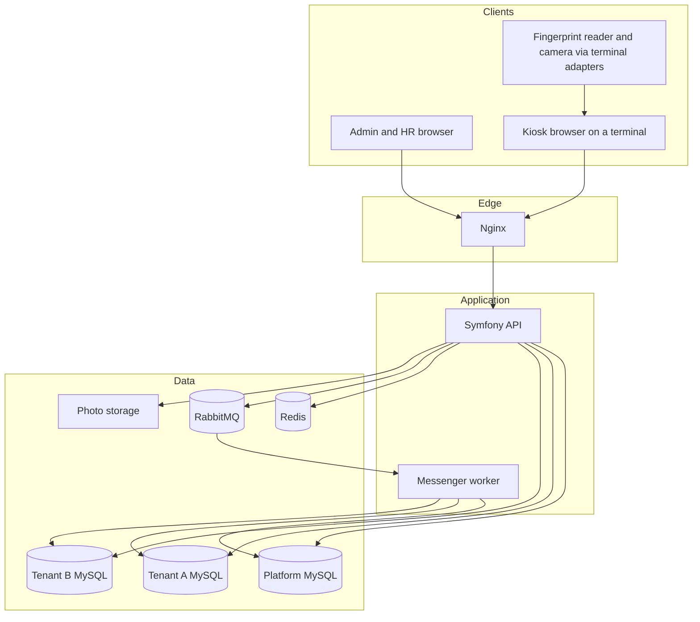
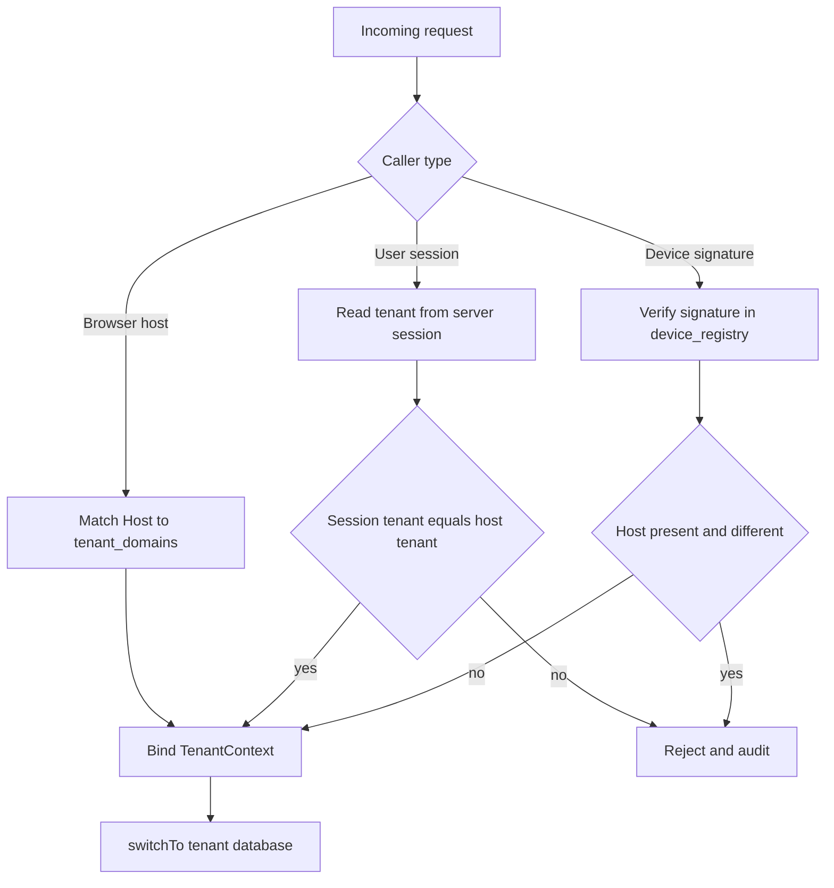
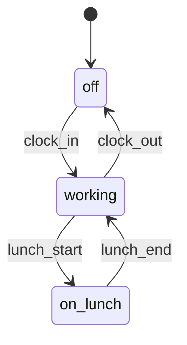
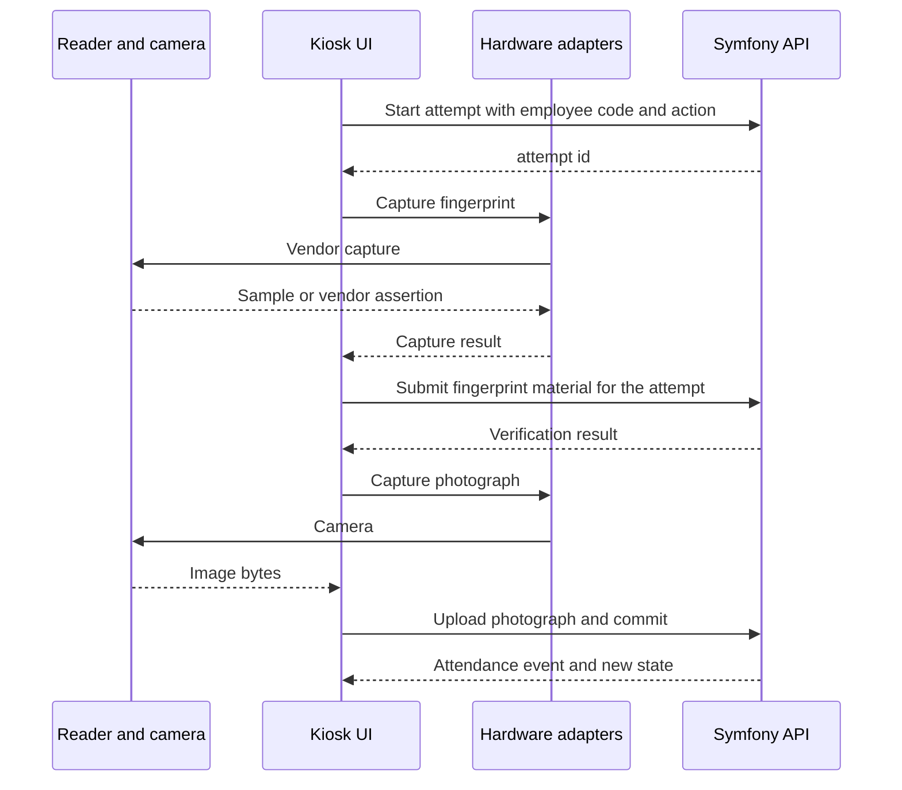
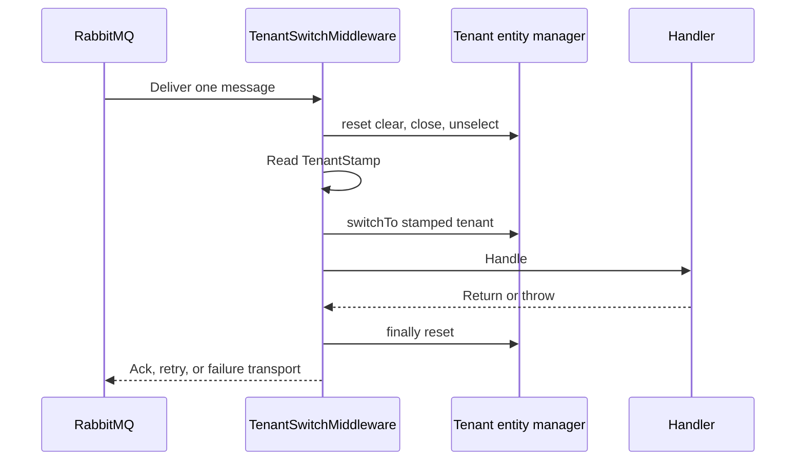

# Architecture

The developer guide is [docs/README.md](README.md). This file is the table-level design and decision log.

Status: the platform registry, dedicated tenant databases, host resolution, connection switching, web sign-in with role permissions, tenant configuration, the employee directory, the attendance state machine, the UTC time model, the terminal kiosk, device registration with Ed25519 request signing, and tenant-scoped domain events are implemented. A production fingerprint vendor and certificate authentication are not. Start the stack with `docs/development.md`. The tenant database design is in `docs/tenant-databases.md`.

The platform is a modular monolith: one Symfony API, one React client, and infrastructure services around them. Tenant isolation is database-per-tenant, with a central platform database as the control plane.

## 1. Multi-tenant architecture

Each customer organization is a tenant. A tenant has its own MySQL database, its own employees, its own attendance history, and its own device operational records. Tenants share the application deployment. They do not share business tables.

Three planes:

| Plane | Responsibility |
| --- | --- |
| Platform (control plane) | Tenant registry, domains, database coordinates, branding, locale and timezone configuration, platform operators, device identity registry, integration registration |
| Tenant (data plane) | Employees, accounts, attendance, biometric templates, photos metadata, device projection, heartbeats, tenant audit |
| Edge | Nginx, React admin UI, React kiosk UI, physical terminal hardware adapters |

A request is bound to one tenant for its whole lifetime. The tenant is chosen by the server from a trusted source: the request host, a server-issued user session, or an authenticated device. The browser cannot select a tenant by sending `tenant_id`.



Deployment shape for the first production version: one application release, one MySQL server hosting the platform database and many tenant databases, one Redis, one RabbitMQ. The connection record for each tenant includes a host, so a tenant database can move to another server later without an application redesign.

## 2. Central platform database

The platform database is the source of truth for who a tenant is and how the application reaches that tenant. It stores no employee personal data, no attendance events, and no biometric templates.

| Table | Purpose |
| --- | --- |
| `tenants` | Id, slug, legal name, status (`provisioning`, `active`, `suspended`, `decommissioned`) |
| `tenant_domains` | Hostname to tenant. One primary host, optional verified custom domains |
| `tenant_database_connections` | Host, port, database name, username, encrypted password ciphertext, encryption key id |
| `tenant_branding` | Company name, logo URL, favicon URL, and color tokens |
| `tenant_locales` | Enabled language codes and the default locale |
| `tenant_settings` | IANA timezone, date format, time format, first day of week, and the photo-required attendance flag |
| `tenant_integrations` | Enabled integration kind, event name, and encrypted configuration. The row stores data, not PHP |
| `platform_users` | Operators of the SaaS itself |
| `platform_credentials` | Password hashes or external identity subject for platform users |
| `device_registry` | Global device id, owning tenant, lifecycle status |
| `device_keys` | Public key, key version, algorithm |
| `device_enrollment_tokens` | Hash of a one-time enrollment token, tenant, expiry, used time |
| `tenant_device_policies` | Optional allowed networks, IP ranges, and application versions for attendance |
| `platform_audit_log` | Platform-operator and registry audit |

Passwords for tenant databases are stored as ciphertext. The master key comes from `TENANT_DB_CREDENTIALS_KEY` or a secret manager. The repository never contains a tenant password, API key, or certificate.

## 3. Tenant database

Each tenant database uses the same schema, applied by a tenant migration set. A tenant database is created only by a platform provisioning operation.

| Table | Purpose |
| --- | --- |
| `departments` | Departments inside the tenant |
| `teams` | Teams, optionally linked to a department |
| `users` | Web accounts for HR, managers, and employees who may sign in |
| `user_credentials` | Password hashes, token version |
| `employees` | Employee number, name, contact details, department, team, employment status, and timestamps |
| `employee_codes` | Keyed hash of the attendance identifier. The typed code is not stored |
| `manager_assignments` | Which manager is responsible for which employees |
| `schedules` | Named schedules for an employee |
| `hr_notes` | HR notes about an employee |
| `devices` | Operational projection: name, location, IANA timezone, reported signals |
| `device_heartbeats` | Health observations |
| `fingerprint_enrollments` | Vendor id, template reference, enrolled time |
| `attendance_attempts` | Short-lived server-side attempt binding code, fingerprint, and photo |
| `attendance_sessions` | Current state row, locked during commit |
| `attendance_events` | Append-only accepted attendance facts |
| `attendance_photos` | Photograph metadata and an opaque storage reference. The image bytes are not in this row |
| `idempotency_keys` | Device retry protection for commit |
| `audit_log` | Tenant security and business audit |
| `integration_deliveries` | Delivery result, event id, tenant id, and a short failure reason |

Employee personal data and biometric material stay in the tenant database that owns them.

### Data ownership

| Data | Database |
| --- | --- |
| Tenant identity, status, slug | Platform |
| Hostnames | Platform |
| Database host, name, username, encrypted password | Platform |
| Branding colors, company name, logo, and favicon | Platform |
| Enabled languages and default language | Platform |
| Tenant IANA timezone | Platform |
| Photo and attendance policy | Platform |
| Integration registration and encrypted integration config | Platform |
| Platform operator accounts | Platform |
| Device id, owning tenant, lifecycle status, public key | Platform |
| Enrollment token hashes | Platform |
| Platform audit | Platform |
| HR users, managers, employee web accounts | Tenant |
| Departments, teams, schedules, HR notes | Tenant |
| Employees and employee codes | Tenant |
| Manager assignments | Tenant |
| Device name, location, device IANA timezone, heartbeats | Tenant |
| Reported MAC, hostname, observed IP | Tenant, as signals |
| Fingerprint templates | Tenant |
| Attendance attempts, sessions, events | Tenant |
| Photograph metadata | Tenant |
| Tenant audit | Tenant |
| Photo bytes | Object storage or file volume, keyed by tenant id, referenced from the tenant database |

Device lifecycle status in the platform registry is authoritative for authentication. The tenant `devices` row is a projection for HR screens and for terminal timezone. If the projection update fails after revocation, authentication still fails closed because the registry was already updated.

## 4. Tenant database connection strategy

Doctrine uses two DBAL connections and two entity managers.

| Connection | Entity manager | Lifetime |
| --- | --- | --- |
| `platform` | `platform` | Stable for the process. Points at `PLATFORM_DATABASE_URL` |
| `tenant` | `tenant` | Closed until a tenant is selected. Reconfigured per tenant |

`TENANT_DATABASE_URL` in the environment is only a boot placeholder so the container can start. A `TenantAwareConnection` refuses `connect()` and query execution until `TenantConnectionSwitcher::switchTo()` has selected a tenant. Application code uses the tenant entity manager only after that selection.

`switchTo(tenantId)`:

1. Load the tenant from the platform database and require status `active`.
2. Decrypt the tenant database password in memory.
3. Close any existing tenant PDO.
4. Clear the tenant entity manager identity map.
5. Set the tenant connection parameters (host, port, database name, username, password, charset).
6. Set the MySQL session time zone to `+00:00`.
7. Mark the connection selected and store a `TenantContext` value object: tenant id, IANA timezone, default locale, enabled locales, photo policy.

`reset()`:

1. Clear the tenant entity manager.
2. Close the tenant PDO.
3. Mark the connection unselected so the next SQL call fails.
4. Drop the in-memory `TenantContext`.
5. Pop any logging context that carried the tenant id.

Rules:

- The tenant PDO is created with persistent connections disabled. A persistent PDO would survive a PHP worker and could be reused against the wrong database.
- The platform connection is never used for tenant queries. Tenant entity mappings are registered only on the tenant entity manager.
- Password material is not logged.
- Version 1 does not cache tenant connections across messages or requests. Reconnecting is cheaper than leaking a connection. A later least-recently-used pool is allowed only if it still clears the identity map and still runs `reset()` between tenants.
- Schema migrations for tenant databases run from a platform command that switches, migrates, and resets, one tenant at a time.

## 5. Tenant resolution

Resolution produces a tenant id before any tenant query. The order depends on the caller.

Browser and HR API:

1. Read the HTTP `Host` and match it to `tenant_domains`.
2. Unknown hosts receive a generic not-found response.
3. On login, the user is loaded from that tenant database only.
4. The server session stores `user_id`, `tenant_id`, and a token version.
5. On later requests, the session tenant must equal the host tenant. A session minted for tenant A and presented to tenant B's host is rejected.

Device API:

1. Authenticate the device against the platform registry (section 11).
2. Take the tenant id from the registry row that owns that device.
3. If the request also has a tenant host, the host tenant must equal the device tenant. A mismatch is rejected and audited.

Platform operator API:

1. Served on a configured platform hostname, which is not a tenant domain.
2. Platform routes do not open a tenant connection unless a platform use case is explicitly provisioning or supporting one tenant.

Ignored as authority:

- `tenant_id` in JSON, query strings, or form bodies
- `X-Tenant-Id` and similar client headers
- Any tenant choice stored in React state or local storage

Those values may be displayed only after the server has resolved the tenant. If a client sends a tenant id and it disagrees with the resolved tenant, the request is rejected.



## 6. Authentication and authorization

Four principals, and they are not interchangeable.

| Principal | How they prove identity | Where the account lives |
| --- | --- | --- |
| Platform operator | Email and password on the platform host. HTTP-only session cookie | Platform database |
| Tenant user (admin, HR, manager, employee) | Email and password on the tenant host. HTTP-only session cookie | Tenant database |
| Device | Ed25519 signature over a canonical request | Platform `device_registry` and `device_keys` |
| Employee at a kiosk | Employee code, then fingerprint, after the device is already authenticated | Tenant database. This identifies the employee. It does not create a web session |

Web sessions:

- Cookie attributes: `Secure`, `HttpOnly`, `SameSite=Lax`, host-only for the tenant hostname.
- Session payload is server-side in Redis. The cookie holds the session id.
- React stores no access token in `localStorage`.
- Each session has a token version checked against the user row so password reset and disablement invalidate open sessions.
- Symfony firewalls are separate for platform routes, tenant-user routes, and device routes. Each protected request loads the account again and checks the token version and the host. The serialized security token is not the access decision.
- `SameSite=Lax` is the protection for cookie-authenticated POST requests.
- A wrong password, an unknown email, and a disabled account return the same `invalid_credentials` problem. The audit record can say which case occurred. An audit failure does not create a session.

Authorization is enforced in Symfony with voters on the use case. React receives the caller's permissions and only uses them to show or hide navigation. Stored role codes are `employee`, `manager`, `hr`, `tenant_admin`, and `platform_admin`. Chief and manager are the `manager` role. Effective permissions come from a code catalog, separate from the role name and separate from the Symfony role hierarchy. `ROLE_*` values only satisfy coarse firewall rules. Roles in version 1:

| Role | Scope |
| --- | --- |
| `ROLE_PLATFORM_ADMIN` | Tenant lifecycle, platform audit |
| `ROLE_TENANT_ADMIN` | Full tenant administration, device enrollment and revocation |
| `ROLE_HR` | Employees, attendance history, reports |
| `ROLE_MANAGER` | Attendance and employees assigned to that manager |
| `ROLE_EMPLOYEE` | Own attendance history when employee web access is enabled |
| `ROLE_DEVICE` | Terminal attempt, heartbeat, and attendance commit for the authenticated device only |

A device role cannot call HR endpoints. A tenant user role cannot commit kiosk attendance by claiming to be a device.

Platform tenant management uses the same registry. `platform_admin` calls `/api/v1/platform/tenants` on the platform host. Listing requires `tenants.manage`. Creating, editing, suspending, reactivating, archiving, dropping a database, migrating, checking a database, and changing usage limits require `tenants.lifecycle`. Reading `platform_audit_log` requires `platform.administer`. The session supplies the actor. The URL slug selects the tenant. A client-supplied tenant id is rejected. Profile edits change the registry row for that slug and do not replace `tenant_database_connections`. A tenant becomes `active` only after its database has been created and migrated. Archive keeps the database. Dropping it is a second confirmed operation, and only after decommission. The HTTP API does not return database passwords.

`platform.database.explore` is granted only to `platform_admin`. It is not implied by `tenants.manage` or `tenants.lifecycle`. The explorer reads through `EXPLORER_PLATFORM_DATABASE_URL` and `EXPLORER_TENANT_DATABASE_URL`. Those accounts are select-only. An empty URL, or an explorer URL that repeats the application MySQL user and password, returns `503` with code `explorer_unavailable`. The server never opens `PLATFORM_DATABASE_URL` or the decrypted tenant password as a fallback. The client sends `platform` or a tenant slug. Host, database name, and credentials are taken from server configuration and `tenant_database_connections`. A tenant id in the path is not a database selector and is not authorization. Provisioning and decommissioned tenants are not listed. Protected tables and columns, including password hashes, tokens, device keys, and fingerprint templates, are removed before the response is built. Table rows are always paginated with bound filters. The SQL console parses each statement with `phpmyadmin/sql-parser` before it runs. That library is the maintained MySQL parser from the phpMyAdmin project. It builds a statement tree, so comments, unions, common-table expressions, and nested queries are checked as structure. `doctrine/sql-formatter` only formats SQL, and `greenlion/php-sql-parser` is not the active MySQL parser. A parse error, more than one statement, or a statement the parser does not recognize is rejected. The original text is not executed. The console rebuilds one allowed `SELECT`, read-only `WITH`, `SHOW TABLES`, `SHOW COLUMNS`, `DESCRIBE`, or `EXPLAIN` of those, and rewrites a SELECT row limit above 1,000 on that tree. Writes, DDL, grants, transaction commands, `SET`, procedure calls, `INTO OUTFILE`, locking reads, other databases, system schemas, and protected tables or columns are rejected. The MySQL session also sets a maximum execution time and a read-only transaction. Those session limits do not replace the parser. An operator can run 20 queries a minute and two at a time. A result stops at 1,000 rows or 512,000 bytes of cell text. Cancelling in the browser aborts the request; MySQL stops a statement that exceeds the session time limit. The audit row stores a hash of the statement with literals removed (`queryHash`), the statement kind, the result, the duration, the row count, and an error category. It does not store the statement text or the rows. Each view is written to `platform_audit_log` with the platform actor, target, UTC time, result, request id, and duration. Row contents and credentials are not stored in that log.

`tenant_quotas` stores `maxUsers`, `maxEmployees`, and `maxActiveDevices`. `null` is unlimited and `0` is a hard stop. Counts are calculated when needed: active rows in the tenant `users` and `employees` tables, and `device_registry` rows whose status is `active`. The tenant `devices` projection is not the device count. User and employee checks lock `quota_guard` in the same transaction as the insert. Device activation locks the platform tenant row, recounts active devices, and changes status only when a seat remains. Reactivating a suspended device uses that same check. A limit below current usage deletes nothing and blocks the next increase. `GET /api/v1/tenant/usage` is read-only for `tenant.configuration.manage`.

## 7. Employee attendance domain

Attendance records that an employee started work, started lunch, ended lunch, or finished work. The terminal is the normal place this happens. HR reads and corrects only through explicit audited use cases, which are later features. The core model does not depend on those screens existing.

Concepts:

| Concept | Meaning |
| --- | --- |
| Employee | A person employed by one tenant. Identified at the terminal by a unique employee code |
| Attendance attempt | A short-lived server record that binds one device, one employee, one intended action, the fingerprint result, and any required photo |
| Attendance session | The employee's current open work period and derived state |
| Attendance event | An immutable accepted fact appended when an attempt commits |

An employee has at most one open session. Sessions may cross local midnight. Calendar-day reports are a presentation concern built from UTC instants and the chosen IANA timezone. They are not the consistency boundary.

Employee code lookup is identification. Fingerprint verification is the check that the person at the terminal is that employee. Both happen on the server side of the attempt. The device being authenticated only proves which terminal is calling.

The directory stores a unique employee number, name, optional email and phone, department, team, one manager, employment status (`active` or `inactive`), and a work-schedule name on `schedules`. Created and updated timestamps are UTC. An employee does not store a separate timezone; admin presentation uses the tenant IANA timezone. The attendance identifier is a random code from a 32-character alphabet. The database stores only its HMAC-SHA256, keyed with the application secret. HR sees the typed code once, when it is generated or reset. The code is not a password and it is not biometric verification.

## 8. Attendance event model

Accepted events are append-only. The server clock is the event time.

| Field | Rule |
| --- | --- |
| `id` | UUID generated by the server |
| `employee_id` | Employee the event belongs to |
| `device_id` | Terminal that submitted the action |
| `session_id` | Session opened or continued by this event |
| `event_type` | `clock_in`, `lunch_start`, `lunch_end`, `clock_out` |
| `occurred_at` | Server UTC time at commit |
| `created_at` | Server UTC time the row was inserted |
| `verification_method` | `fingerprint` on an accepted event. `code` identifies an employee and cannot accept an event by itself |
| `photo_id` | Required for `clock_in` under the default photo policy |
| `source` | `terminal` for a kiosk commit |
| `idempotency_key` | Retry key, unique together with `device_id` |
| `metadata` | Audit context for the commit. The typed attendance code is not stored |

The typed attendance code is not copied onto the event. Display conversion uses the tenant IANA timezone at read time. The event does not store an offset.

`occurred_at` is never taken from the browser or the terminal clock. A client-supplied timestamp may be stored on the attempt as an untrusted observation. It is not the attendance time and it is not used in calculations.

Rejected scans are not attendance events. They remain on `attendance_attempts` and `audit_log` with a reason such as unknown code, fingerprint mismatch, illegal transition, missing photo, or inactive employee.

Commit is idempotent. The same device and idempotency key returns the original event instead of appending another.

## 9. Attendance state machine

States: `off`, `working`, `on_lunch`.



| From | Action | To | Fingerprint | Photograph |
| --- | --- | --- | --- | --- |
| `off` | `clock_in` | `working` | Required | Required by default |
| `working` | `lunch_start` | `on_lunch` | Required | Not required |
| `on_lunch` | `lunch_end` | `working` | Required | Not required |
| `working` | `clock_out` | `off` | Required | Not required |

Any other pair is rejected. Clocking out during lunch is rejected. The employee ends lunch first, then clocks out, so the record keeps both facts. A second clock-in while `working` is rejected. Ending lunch while `off` or `working` is rejected. Starting lunch while `off` or `on_lunch` is rejected.

`AttendanceLedger` is the only writer. It folds `attendance_events` after locking `attendance_guards` for that employee, then appends one event and updates the open `attendance_sessions` row in the same transaction. The caller sends the requested action. The current state is not accepted from the client. A repeated device id and idempotency key returns the original event. A session may cross UTC midnight and a daylight-saving change; elapsed time is the difference of the UTC instants.

`attendance_sessions.open_employee_id` is set only while the employee is `working` or `on_lunch`, and that column is unique. On MySQL the commit locks `attendance_guards` with `FOR UPDATE`. SQLite has no row lock, so that engine also takes an exclusive lock for the database file during the commit. Together with the unique open session, two terminals cannot append conflicting events for one employee. Verification methods are `code` and `fingerprint`, with room for another method on `VerificationMethod`. `VerificationPolicy` accepts `fingerprint` for a recorded event. `code` remains identification. The terminal attempt API checks a device signature, identifies the employee from the code, verifies a fingerprint through `FingerprintMatcher`, stores a photograph when the server requires one, and commits through this ledger. The production matcher is still the unavailable implementation until a vendor is connected. The mock matcher runs only in development and test.

Commit transaction, inside the tenant database:

1. Lock the employee's `attendance_sessions` row.
2. Reload the attempt and require the same device, a successful fingerprint, a required photo when the action is `clock_in`, and an attempt that has not expired.
3. Re-read device status from the platform registry and require `active`.
4. Evaluate the transition from the locked current state.
5. Insert the attendance event with server UTC time.
6. Update the session projection in the same transaction.
7. Mark the attempt committed.

The lock makes two terminals unable to commit conflicting transitions for one employee.

Default attempt lifetime is two minutes from issuance. Expired attempts cannot commit. Photograph policy lives in platform `tenant_settings`. The default requires a photo for successful clock-in only. Additional capture points are configuration, not a second state machine.

## 10. Physical terminal architecture

A terminal is a computer attached to a fingerprint reader and a camera, running the kiosk UI in a browser. The server does not talk to USB devices. The kiosk talks to local hardware through adapter interfaces, then calls the API.



Terminal flow:

1. The kiosk already has a device identity and private key from enrollment.
2. The employee scans or types an attendance code. The server identifies the employee inside the authenticated terminal's tenant and opens an attempt. The request does not choose an attendance action. An unknown code and an inactive employee produce the same generic message.
3. The kiosk shows the employee's name and asks for confirmation.
4. The kiosk captures a fingerprint through the hardware abstraction. A timeout or a failed match stops there. No attendance event is created.
5. The server verifies the sample. Only then does it return the actions that are legal for the current state, and whether the chosen action needs a photograph.
6. The kiosk can continue with an action only when that action is in the server response. A single legal action continues on its own. Several legal actions are shown as the only choices.
7. When the server marks the action as requiring a photograph, the kiosk captures one and uploads the bytes. A camera failure can be retried and does not create an event.
8. The server commits with its own UTC clock and checks the transition again. A repeated commit for the same attempt and action reuses one idempotency key.
9. Success shows the employee name, the action the server recorded, and that instant in the terminal's local timezone. The screen then returns to idle. Failure shows a short message and returns to idle as well. While the readiness check is failing, the idle screen says the server is unavailable and does not accept a code.

The kiosk states are `idle`, `identifying`, `employee_found`, `waiting_for_fingerprint`, `verifying`, `choosing_action`, `capturing_photo`, `processing_attendance`, `success`, `error`, and `timeout`. Success, error, and timeout return to the idle screen. The kiosk has no route into administration. Redux keeps the attempt id, the display name, the employee number, the server action list, and the result time. It does not keep the attendance code, the fingerprint sample, or the photograph bytes.

The kiosk does not decide the state transition. It displays the actions the server says are legal for that employee.

Hardware that is not present is represented by the adapter returning a typed unavailable result. The API does not invent a successful scan.

## 11. Terminal authentication

A terminal is authenticated only by proving it holds the private key that matches the public key stored for its server-generated device id. The device id and the public device UUID are the same value. `X-Device-Id` carries that UUID.

MAC address, IP address, hostname, and process id are not credentials.

- A MAC address is a locally configured interface property. Software and many network adapters can present any value. It is not a secret, so anyone who can see it can copy it. It can identify a report, and it cannot prove that a particular terminal sent the request.
- An IP address is assigned by the network. NAT, DHCP, and proxies mean many terminals share an address, and one terminal changes address. A client can also put a different address in a header. The server records only the observed peer address, and it uses that address as a policy signal when the tenant configured an allowed range.
- A hostname is chosen on the machine. It is not issued by the server and it is not secret.
- A process id is assigned by the operating system, reused after the process exits, and visible to anything on the machine. It does not identify a tenant, a device, or a key. The API discards `processId` and `pid` and never stores them.

Those values may be stored as optional metadata and, when a tenant configures a policy, the observed peer IP, the reported network name (`X-Device-Network`), and the reported application version (`X-Device-App-Version`) can reject an already authenticated device. An empty policy does not reject. A certificate reference can be stored for inventory. It does not authenticate. The active credential is the current Ed25519 public key, referenced by `credentialRef`.

Each device request includes:

| Header | Content |
| --- | --- |
| `X-Device-Id` | Device UUID |
| `X-Device-Timestamp` | Unix time in UTC |
| `X-Device-Nonce` | Unique nonce |
| `X-Device-Signature` | Ed25519 signature |
| `X-Device-App-Version` | Optional application version used by policy |
| `X-Device-Network` | Optional network name used by policy |

The signed payload is the UTF-8 string:

```text
v1
{timestamp}
{nonce}
{HTTP method}
{request path}
{sha256 of the raw body}
```

The API:

1. Loads the device. A missing device or a missing public key returns `401` `device_rejected`.
2. Requires the timestamp to fall within 60 seconds of server UTC and the nonce to match the allowed shape.
3. Verifies the signature with the stored public key. A bad signature returns `401` `device_rejected`.
4. Requires status `active`. Any other status, after a valid signature, returns `403` `device_inactive`. Status is checked only after the signature so a caller without the key does not learn the lifecycle state.
5. Stores the nonce in the cache at `device-nonce.{device_id}.{nonce}` with a 120-second TTL. A duplicate nonce is rejected.
6. Requires the request host to be that device's tenant, then switches to the tenant database.

Before an attendance attempt is opened or committed, the server checks again: the device authenticated, the device exists, it is `active`, it belongs to the host tenant, its credential is present, and any configured network, IP-range, or application-version policy matches. A policy failure returns `403` `device_policy`. Heartbeat does not apply that policy, so an out-of-policy device can still report that it is alive.

Device routes and user routes use different Symfony firewalls. A user session cookie is not accepted on device routes.

## 12. Device registration and revocation

Registration:

1. A tenant admin, already authenticated on that tenant, registers a terminal. The platform creates `device_registry` in `pending`, bound to that tenant, and returns a one-time registration token.
2. The platform stores only an HMAC-SHA256 of the token, keyed with the application secret. The token expires after 15 minutes and can be used once. The plaintext is shown once.
3. The terminal generates an Ed25519 key pair, presents the token and the public key on `POST /api/v1/public/terminals/enroll`, and keeps the private key.
4. The server consumes the token, checks that the request host is the token's tenant, installs the public key, and marks the device `registered`.
5. When the terminal was created with `requireActivation` false, the same request activates it. When `requireActivation` is true, it stays `registered` until a tenant admin activates it. Attendance and heartbeat require `active`.
6. The terminal stores `{deviceId, seed}` locally. The server never returns the private key.

Lifecycle:

| Status | Authentication | How it is reached |
| --- | --- | --- |
| `pending` | Rejected | A tenant admin registered the terminal and the key is not installed yet |
| `registered` | Rejected | The terminal installed its key and activation is still required |
| `active` | Accepted | Enrollment with activation, or an admin activation of a registered or suspended device that already has a key |
| `suspended` | Rejected | Suspension of a pending, registered, or active device. Activation can restore a suspended device that has a key |
| `revoked` | Rejected | Revocation. The device id is not reused and activation is refused |

HTTP activation refuses a device that has no public key. The CLI activation used by provisioning checks can still mark a keyless pending device active; signatures without a public key remain `device_rejected`.

Credential rotation issues a new one-time token and leaves the status unchanged. Completing rotation installs a new current key and retires the previous key. Revocation sets `revokedAt`, invalidates unused tokens, and keeps the public key so an old signature can be explained. The status check still rejects it.

Heartbeat is `POST /api/v1/terminal/heartbeats`. It requires an authenticated `active` device. It records the observed peer IP, reported metadata, and adapter names in the tenant `device_heartbeats.payload`, and updates `lastHeartbeatAt` on the registry. It does not extend trust and it is not written to the audit log.

The terminal timezone is chosen by the administrator at registration, or it falls back to the tenant timezone. The server validates it against the IANA database and stores it on the tenant device projection for presentation.

Tenant administrators manage terminals at `/terminals` when they have `terminals.manage`. They can register, activate, suspend, revoke, rotate the credential, read last seen and status, and read the audit history. HR and employees do not have that permission. The kiosk can enter a registration code and has no route into administration.

## 13. Fingerprint abstraction

No vendor SDK is part of this repository. The attendance domain depends on `FingerprintMatcher`. That matcher delegates to `FingerprintReader`, which is the server port for verify, enrollment status, availability, and health. The kiosk depends on `TerminalDeviceService`, which calls `FingerprintDevice` and `CameraDevice`. `MockFingerprintAdapter` and `MockCameraAdapter` implement those ports for development and tests. A production process without a vendor adapter reports `device_unavailable` and does not invent a scan.

The reader result carries success or failure, the vendor id, a server-generated verification id, and one of `device_unavailable`, `device_disconnected`, `fingerprint_mismatch`, `timeout`, `capture_failed`, or `hardware_communication_failure`. It does not carry the biometric payload. Enrollment status is `enrolled`, `not_enrolled`, or `unknown`. The mock returns `unknown` because it stores no template. Adding a vendor adapter is described in `docs/terminal-hardware.md`.

Two vendor shapes are allowed behind the same server interface:

| Mode | What the server checks | When it is used |
| --- | --- | --- |
| Server-side match | The matcher compares the submitted sample with templates stored in the tenant database | Preferred. Used whenever the vendor can run a matcher on the server or the server can compare templates |
| Terminal assertion | The device signs a vendor result that names the attempt, the employee, and the outcome. The server checks that device signature, freshness, and employee binding | Used only when the vendor SDK cannot leave the terminal |

Terminal assertion mode trusts the enrolled device to perform the biometric comparison. It is still checked server-side as a signed assertion. It is not treated as equivalent to a server-side template match. The active mode is a deployment choice behind `FingerprintMatcher`, not a branch in the attendance state machine.

Templates, when stored, live in the tenant database. They are not written to the platform database or to logs.

## 14. Camera and photo abstraction

The kiosk captures the image through `CameraDevice`. The server stores bytes through `MediaStore` and records only a photo id on the attempt and the attendance event. A raw fingerprint image is not stored. The storage strategy, access rules, and the later object-storage adapter are documented in `docs/media-storage.md`.

Default policy: a clock-in commit requires one photograph captured after fingerprint success for that same attempt. Lunch start, lunch end, and clock out do not require a photograph unless `tenant_settings` later enables that.

The server checks content type, size, image structure, and active-content markers before storing. The tenant database stores metadata and a hash. It does not store the image and it does not return a filesystem path. `GET /api/v1/hr/attendance-photos/{id}` returns the bytes only to a user who may view that employee in the current tenant. `DELETE` on the same path is limited to users who manage employees. A device signature does not authorize that route.

The attempt id binds the photo to the fingerprint result. A photo uploaded for a different attempt, device, or employee cannot be used to commit. `tenant_settings.photo_retention_days` is optional. When it is set, a new photograph expires that many days after capture and is overwritten and removed on the next authorized read.

## 15. React architecture

One React application with three shells, chosen from the route and the host. The host is whatever the browser already used. The UI does not offer a tenant switcher.

| Shell | Host | Routes | Principal |
| --- | --- | --- | --- |
| Platform | Platform hostname | `/platform`, `/platform/new`, `/platform/:slug`, diagnostics `/` | Platform operator |
| Management | Tenant hostname | `/me`, `/team`, `/hr`, `/settings` | Tenant user |
| Kiosk | Tenant hostname | `/kiosk` | Enrolled device |

```text
frontend/src/
  main.tsx
  app/
    store.ts
    router.tsx
    providers.tsx
  shared/
    api/
      baseApi.ts
      userClient.ts
      deviceClient.ts
    theme/
    i18n/
    ui/
  features/
    session/
    branding/
    employees/
    attendance/
    devices/
    reports/
    kiosk/
```

`userClient` sends the session cookie and does not add a tenant header. `deviceClient` signs requests with the terminal private key. Feature screens call these clients through RTK Query. Shared UI components do not know which tenant database exists.

The management shell groups routes by area: employee (`/me`), chief/manager (`/team`), HR (`/hr`), tenant administrator (`/settings`), and platform operator (`/platform`). Each route names one permission and hides itself when the session payload does not include it. That check is presentation. The API rejects the same call when the session lacks the permission. `/app` and `/people` remain as aliases of the employee dashboard and the HR employee list. `/kiosk` stays outside the management shell.

Branding and locale are loaded from public endpoints that resolve the tenant from `Host`. The kiosk shell is full screen and shows only the attendance flow. Management screens are responsive and are not the kiosk. An error boundary covers the management outlet. Lists show loading, empty, and error states. Form fields stay in the component that owns the form.

## 16. Redux Toolkit architecture

Server state and UI state are separate.

| State | Mechanism | Contents |
| --- | --- | --- |
| HTTP cache | RTK Query `baseApi` | Employees, attendance, corrections, schedules, users, audit, devices, reports, settings |
| Session mirror | `session` slice | Display name, kind, roles, and permissions returned by the server |
| Branding | `branding` slice | Color tokens, logo URL, tenant display name |
| Locale | `i18n` | Active language |
| Kiosk progress | `kiosk` slice | Current attempt id and step |

Feature APIs inject endpoints into `baseApi`. There is no Redux slice per form or per domain. Employee, attendance, dashboard, device, report, settings, and notification data stay in the RTK Query cache. Components do not hand-roll fetch caching beside RTK Query.

The store does not contain an authoritative `tenantId`. A display name cached from branding is not sent back as an authorization field. Kiosk attempt state is discarded on logout of the device or on attempt expiry.

## 17. API architecture

JSON over HTTPS, versioned under `/api/v1`. Errors use `application/problem+json`. Collection reads use cursor pagination. Commands that append attendance send `Idempotency-Key`.

Route groups:

| Prefix | Authentication | Examples |
| --- | --- | --- |
| `/api/v1/public` | None. Tenant from host | Branding, enabled locales |
| `/api/v1/platform` | Platform session | Tenant lifecycle |
| `/api/v1/auth` | Tenant host, then session | Login, logout, current user |
| `/api/v1/hr` | Tenant user session and role | Employees, history, device administration |
| `/api/v1/terminal` | Device signature | Attempts, fingerprint, photo, commit, heartbeat |

Terminal attendance is an attempt resource:

| Method and path | Effect |
| --- | --- |
| `POST /api/v1/terminal/attempts` | Body: employee code and action. Returns attempt id and current legal state |
| `POST /api/v1/terminal/attempts/{id}/fingerprint` | Verifies the sample or assertion for that attempt |
| `POST /api/v1/terminal/attempts/{id}/photo` | Stores the photograph when the action requires one |
| `POST /api/v1/terminal/attempts/{id}/commit` | Runs the state machine and appends the event |
| `POST /api/v1/terminal/heartbeats` | Records device health |

HR history, dashboards, and reports are read models over `attendance_facts`, the view of immutable `attendance_events` plus approved `attendance_adjustments`. An employee requests a correction with a local date, requested time and action, reason, comment, and supporting note. A manager reviews assigned employees. HR reviews the tenant. Approval appends an adjustment and reconciles the open session projection. Rejection leaves both the events and the session unchanged. Ordinary users have no route that updates or deletes an attendance event. Stored instants stay UTC. `GET /api/v1/me/dashboard` returns the signed-in employee's current state, today's clock-in, lunch periods, clock-out, worked seconds, and a page of history. `GET /api/v1/hr/dashboard` returns live counts for people working, on lunch, and not clocked in, plus that day's attendance, missing clock-outs, and the number of pending corrections. A manager uses the same route, limited to assigned employees. `GET /api/v1/hr/reports` accepts `display` (`tenant`, `terminal`, `browser`, or `report`), an IANA `timezone`, `browserTimezone`, `deviceId`, `date` or `from` and `to`, `employeeId`, `teamId`, `departmentId`, `eventType`, `status`, `limit`, and `offset`. Those parameters choose the rows and the presentation. They do not accept a tenant id or an official event time. Worked time is the timestamp difference of the UTC instants, clipped to the local day. A shared report timezone applies that local day in SQL. A terminal display without one device keeps each device zone and applies the local day after a widened UTC read. The default report page size is 50.

Report indexes are `idx_attendance_event_employee (employee_id, occurred_at)`, `idx_attendance_employee_type_time (employee_id, event_type, occurred_at)`, `idx_attendance_occurred (occurred_at, employee_id)`, `idx_attendance_device_time (device_id, occurred_at)`, `idx_adjustment_employee_type_time (employee_id, event_type, occurred_at)`, `idx_employees_department (department_id)`, `idx_employees_team (team_id)`, `idx_manager_assignment_manager (manager_employee_id, employee_id)`, `idx_manager_assignment_employee (employee_id, created_at)`, and `idx_correction_status_employee (status, employee_id)`. `GET /api/v1/me/attendance` and `GET /api/v1/hr/attendance` accept `limit`, `offset`, and `date`. The default page is 50 rows. A known timezone applies that local day in SQL. A terminal display without one device reads a widened UTC window and then pages the rows that fall on the local day.

The OpenAPI description is generated from the Symfony API when the API is implemented. This document is the contract until then.

## 18. UTC and timezone strategy

All authoritative timestamps are UTC. The server decides an attendance instant with `UtcClock`. A browser clock and a terminal clock are not written as `occurred_at`.

PHP's default timezone is `UTC` in the container and in the test runner. Both Doctrine connections set the MySQL session time zone to `+00:00` on connect. Timestamp columns are `DATETIME` and store the UTC civil time, for example `2026-10-07 06:42:15`. The application does not use MySQL `TIMESTAMP`, so MySQL does not convert the value with the session time zone. `UtcTime::persist` converts a timezone-aware `DateTimeImmutable` to UTC before formatting, so a change to the server's local zone cannot change the stored instant.

API timestamp fields use ISO-8601 UTC with a `Z` suffix, for example `2026-10-07T06:42:15Z`. Domain code keeps `DateTimeImmutable` values that carry the UTC zone. Display strings are created at the edge and are never used to calculate a duration.

Tenant timezone and terminal timezone are IANA names validated with the PHP timezone database, for example `Europe/Stockholm`, `America/Chicago`, and `Pacific/Auckland`. `UTC` is allowed. Fixed offsets and offset-style names such as `UTC+1`, `+01:00`, `GMT`, and `Etc/GMT-1` are rejected. A user may choose a browser IANA zone or an explicit report IANA zone for display. Those choices are not configuration offsets and they do not change the stored instant.

| Use | Timezone |
| --- | --- |
| Stored event time and API `occurredAt` | UTC |
| Kiosk "today" and local clock display | Terminal IANA timezone from `devices.timezone` |
| Default admin views | Tenant IANA timezone |
| A specific report run | Requested IANA timezone, defaulting to the tenant timezone |
| Browser timezone | Display hint for that user only, when they choose it |

Example: the stored instant `2026-10-07T06:42:15Z` is `2026-10-07 08:42:15` in `Europe/Stockholm`.

Duration is `end->getTimestamp() - start->getTimestamp()` through `UtcTime::durationSeconds` and `AttendanceDuration::seconds`. A report's local day is the half-open interval from local midnight to the next local midnight, converted to UTC. That interval is 23 hours on the Europe/Stockholm spring-forward day and 25 hours on the fall-back day. An instant just before UTC midnight can belong to the next local date. The same UTC instant can belong to different local dates for two terminals.

`GET /api/v1/hr/reports` and the dashboards return `occurredAt` in UTC and `displayedAt` in the selected IANA zone. `display=terminal` reads each event's device timezone, or one terminal's zone when `deviceId` is set. `display=browser` uses the `browserTimezone` query only for `displayedAt`. `display=report` uses `timezone` and otherwise the tenant timezone. A client `occurredAt` parameter is ignored. A `tenantId` value is not a report filter; a claim that disagrees with the host is rejected. Durations are returned as whole seconds from the UTC instants.

## 19. Tenant themes

Branding is platform data: company name, an https logo URL, an https favicon URL, and the color tokens `color_primary`, `color_secondary`, `color_accent`, `color_surface` (background), and `color_text`. Colors are validated as six-digit hex values on write. `GET /api/v1/public/branding` returns that configuration for the host-resolved tenant. The platform host receives the default palette. The response varies on `Host` and is a private response that must be revalidated, so a shared cache cannot reuse one tenant's theme for another. The React client keeps the payload in its request cache and refetches it when a setting is saved or the window regains focus.

The theme module writes the tenant colors to `--brand-*` custom properties and the shared style scale to `--radius-*` and `--border-width`. Components use `--color-*`, radius, and border variables. They do not embed a tenant palette. There is no compiled theme per tenant and no tenant id in the stylesheet. The management and kiosk shells wait until that public branding response has been applied, or until the request fails and the platform default palette is used. Light and dark appearance remix surface, text, card, and line from the tenant background and text colors. Primary, secondary, and accent stay the tenant's brand colors. Contrast text on those brand colors is derived from luminance and stored as `--brand-on-primary` and `--brand-on-secondary`. A logo is shown only when its URL uses `https`.

A suspended tenant does not receive a branded application shell. An unknown host is rejected.

## 20. Internationalization

Shipped catalogs live in the frontend, initially `en` and `sv`. The server allow-list is `LanguageCatalog`. Adding a language means adding the code there and a catalog file in the frontend. Attendance and authorization code does not branch on a language. The tenant chooses the enabled subset and the default. The UI uses the user's saved preference when that language is both shipped and enabled for the tenant. Otherwise it uses the tenant default, then the shipped fallback `en`.

Language negotiation does not change tenant resolution. Catalogs are not a place to pass tenant identity. The signed-in preference is stored under `locale`. The terminal preference is stored under `terminal.locale`. Each is used only when that language is shipped and enabled for the tenant. Dates and times use the tenant date format, time format, and IANA timezone. Numbers use `Intl.NumberFormat` for the active language. The first day of the week is `0` (Sunday) or `1` (Monday). Attendance configuration currently stores whether a photo is required. It does not run the attendance state machine. User-visible copy comes from the catalogs. Stable audit action codes and server diagnostic details stay as returned.

A later `TenantTranslationCatalog` may override individual strings per tenant. Version 1 does not include a translation editor. Dates and times are formatted with the active locale and the selected IANA timezone, using the UTC instant from the API.

Server error codes are stable identifiers. The client maps them to translated messages. The server may include an English `detail` for logs. The UI does not assume `detail` is the only copy.

## 21. Tenant-specific event handling

Attendance commits inside the tenant transaction first. After commit, the application publishes a domain event. Integration failure does not roll back attendance. An idempotent replay does not publish a second event.

The contract is `docs/domain-events.md`. The event names are `EmployeeClockedIn`, `LunchStarted`, `LunchEnded`, `EmployeeClockedOut`, `AttendanceCorrectionRequested`, `AttendanceCorrectionApproved`, `AttendanceCorrectionRejected`, `TerminalRegistered`, and `TerminalSuspended`.

Tenant-specific behavior is a fixed catalog: webhook, notification, email, internal audit, and the shared attendance queue. A tenant administrator enables one of those kinds and supplies a small text configuration. The platform stores that configuration as ciphertext. Tenants cannot upload PHP, name a class, or run a shell command. A webhook must be `https` and cannot target a local, private, or reserved address.

`tenant_integrations` in the platform database records which kinds are enabled. A single Messenger consumer receives `TenantDomainEventMessage` from the shared `async` transport. The message is stamped with the tenant id by server code. The worker switches to that stamp, and the handler refuses the message when the body tenant id differs. It then loads enabled integrations for the stamped tenant and invokes the matching catalog action. Handlers do not open database connections themselves.

A failed action is written to `integration_deliveries` and audited, then Messenger retries it. The last failure is copied to the `failed` transport and audited as dead on the stamped tenant's database. External systems do not publish onto the domain queue.

Core attendance code does not contain tenant-specific branches.

## 22. Audit logging

Audit rows are append-only. Updates and deletes are not part of the application API.

Platform audit covers tenant provisioning, suspension, connection changes, branding changes, device enrollment, activation, suspension, revocation, and platform logins.

Tenant audit covers login, logout, authentication failure, employee creation, update, and deactivation, attendance corrections, role changes, tenant configuration, device registration, activation, suspension, revocation, and credential rotation, photograph access, sensitive configuration reads, and failed or dead integration deliveries.

Each row records the tenant, actor type (`platform_user`, `tenant_user`, `device`, `system`, `anonymous`), actor id, action, resource type, resource id, UTC time, request correlation id, result (`success` or `failure`), client IP, and the device id when the caller is an authenticated terminal. Metadata is JSON. Passwords, fingerprint samples, photographs, tokens, private keys, and ciphertext are removed before the row is written.

Sign-in is limited to 8 failures for an email address and 40 for an IP address on that host, counted over 15 minutes. Terminal signature failures are limited the same way. A further attempt returns `rate_limited`. Session cookies are HttpOnly and SameSite=Lax. A mutating request whose `Origin` names another host is rejected with `csrf_rejected`. CORS allows only that same host. API responses send `nosniff`, a frame denial, `no-store`, and a locked content security policy. Attendance commits stay idempotent for a device and key. A terminal nonce cannot be replayed inside its time window.

Audit writes for a successful attendance commit happen in the same tenant transaction as the event. Authentication failures write audit after the failure, and a logging failure must not convert a rejected authentication into a success.

## 23. Background processing

Symfony Messenger with a RabbitMQ transport handles integration dispatch, photo post-processing, and projection repair. The HTTP request does the attendance transaction itself. It does not wait for integrations.

Queue isolation is logical. Version 1 uses shared queues, not a queue per tenant. Tenant separation is the worker's connection switch, not the broker.

Every domain message that touches tenant data carries a `TenantStamp` created on the server. The stamp is not a field the client can set. Dispatch middleware copies the tenant id from the active `TenantContext`. If a message also contains a tenant id and it differs from the context, dispatch throws. The connection switch runs only for envelopes that carry `ReceivedStamp` (messages a worker pulled from a transport). A dispatch during an HTTP request must not reset the tenant connection already opened for that request. Platform provisioning code may stamp a tenant it just authorized, using a factory in server code, not the request body.

Worker algorithm:



Leak controls:

| Channel | Control |
| --- | --- |
| PDO left on the previous tenant | `reset()` closes it and `TenantAwareConnection` refuses queries while unselected |
| Doctrine identity map | `clear()` on the tenant entity manager before and after the handler |
| `TenantContext` still set | Cleared in `finally` |
| Log context | Tenant id pushed after switch and popped in `finally` |
| Static or in-memory caches | Forbidden in handlers and Doctrine listeners for tenant data |
| Redis | Tenant keys use the prefix `tenant:{tenant_id}:`. Platform keys use `platform:` |
| Message forged by an external publisher | Domain queues accept publishes from the Symfony application. Ingress re-stamps only after credential checks |
| Prefetch mixing tenants inside one process | Symfony 7.4 AMQP transport pulls with `basic.get`, one message per worker iteration. The removed `prefetch_count` option is not set |
| Reset failure | Fatal to the worker process so the supervisor restarts it. The process must not handle another message |

A batch that covers many tenants is a platform query followed by one stamped message per tenant. A handler does not loop across tenant databases.

The `async` transport retries a failed domain message twice and then moves it to the `failed` transport. Each failed attempt is audited in the stamped tenant database. The dead-letter listener switches to the stamp, writes status `dead`, and resets. It does not open the tenant named in a mismatched message body.

The consume command is run with a memory limit and a message limit so the process recycles. That recycling is extra containment. Correctness still depends on `reset()`, not on process exit.

PHP-FPM is the HTTP runtime for version 1, so request memory disappears after the response. The tenant connection is still closed at the end of the request. If HTTP later moves to a long-lived runtime, that runtime must run the same reset at the end of every request.

Device heartbeats stay on the HTTP request. The terminal reads the stored observation immediately, so the write is not queued. Domain events remain the Messenger workload.

## 24. Testing strategy

The executable map of unit, integration, API, authorization, tenant-isolation, attendance, device, timezone, correction, event, and frontend tests is in `docs/testing.md`. That document names the test for each critical attendance scenario. Hardware is not required. `MockFingerprintAdapter` and `MockCameraAdapter` cover the hardware ports, including a reader or camera that is unavailable. Production configuration tests assert the mock matcher is not selected when `APP_ENV=prod`.

Failed tests stop the change. They are not skipped to finish a task.

## 25. Docker and deployment strategy

Local development uses `docker-compose.yml`: Nginx, PHP-FPM, one Messenger consumer, MySQL, Redis, RabbitMQ, and the Vite dev server. `APP_ENV` is `dev` and the data stores publish ports on the workstation. Staging and production use `docker-compose.prod.yml`. The procedure, the environment variables, backups, and the migration order are in `docs/deployment.md`.

| Service | Development | Staging and production |
| --- | --- | --- |
| `nginx` | HTTP, Vite proxy | Built React files. TLS at Nginx, or HTTP behind a TLS load balancer |
| `php` | Bind-mounted source, debug on | Immutable image, `APP_DEBUG=0`, opcache timestamps frozen |
| `messenger` | One consumer. Docker restarts it after the time limit | Same image and command, health check, `restart: unless-stopped` |
| `mysql` | Published port | Private network, UTC, `local-infile` off. Backups cover the platform database and every tenant database |
| `redis` | Published port, no password | Password, AOF, no published port |
| `rabbitmq` | Management UI published | Broker only, no published port |

A production process refuses to boot when debugging is on, when a known development secret is still set, when the tenant driver is SQLite, when Redis has no password, or when `DEFAULT_URI` is not HTTPS. The production image does not contain `backend/.env` or the test configuration. Session cookies are `Secure`. PHP-FPM trusts only its direct proxy (`TRUSTED_PROXIES=REMOTE_ADDR`), which is Nginx.

The consumer switches the tenant connection from the message stamp and clears it when the message finishes, when the handler fails, and when the worker starts. A message is handled for one tenant, then the connection is closed before the next message.

Deployment applies platform migrations, then `app:tenant:migrate --all`, then starts PHP and the consumer. A new tenant is created with `app:tenant:provision`, which creates that database, stores the encrypted password, and migrates it. Compose does not hardcode tenant passwords.

Photographs stay on the private `media_data` volume (`MEDIA_LOCAL_DIRECTORY`). Nginx does not serve that directory. An S3-compatible store remains the later adapter described in `docs/media-storage.md`.

Custom-domain certificates are mounted into Nginx or terminated at the load balancer. Issuing those certificates is an operations concern.

## 26. Attendance query scale

Attendance reads are scoped by the server tenant connection. They do not add a tenant id predicate inside the tenant database. The indexes below match the filters those reads already use.

| Lookup | Index |
| --- | --- |
| One employee's ledger, including the latest fact | `attendance_events (employee_id, occurred_at)` and the same leading columns on `attendance_adjustments` |
| Event type inside that ledger, including the prior clock-out used by a day summary | `(employee_id, event_type, occurred_at)` on events and on adjustments |
| A tenant date range | `(occurred_at, employee_id)` |
| One terminal's events | `(device_id, occurred_at)` |
| Open correction for an employee and local day | `(employee_id, local_date, status)` |
| Correction list, newest first | `(created_at)` |
| Manager's assigned employees, and the reverse lookup from an employee | `(manager_employee_id, employee_id)` and `(employee_id, created_at)` |
| Latest schedule | `(employee_id, created_at)` |
| Attempt by device and status | `(device_id, status)` |
| Heartbeat history | `(device_id, observed_at)` |
| Tenant audit, newest first | `audit_log (occurred_at)` |
| Platform audit, newest first | `platform_audit_log (occurred_at)` |
| Tenant host | unique `tenant_domains.hostname` |

`attendance_facts` is a view. The indexes sit on `attendance_events` and `attendance_adjustments`, which are the two branches of that view.

The employee roster and the user list are one join each. The roster includes the latest manager, the latest schedule, and whether an attendance identifier exists. It is not paged: the people screen and the report filters need the whole roster, and one join replaces the previous per-employee reads. Account roles are joined in that same user query.

Dashboards count who is working, on lunch, and off by taking each scoped employee's latest fact, then page the selected day's rows. The counts need the whole scoped population, so the daily page is sliced after that pass. The pass is a fixed set of statements, not one query per employee. Live state is the latest attendance fact. `employees.status` is the employment flag and is read with the person, not through a separate status scan.

Ledger, correction, and audit screens accept `limit` and `offset`. The default page is 50 rows, and a page cannot exceed 100. An undated ledger page is the newest rows, shown in chronological order inside the page. A dated ledger with one shared timezone puts the local-day bounds in SQL. A terminal display that keeps each device zone reads a widened UTC window for that date, drops rows outside the device's local day, and then pages the remainder. Device timezones used while formatting a page are remembered for that request.

Tenant resolution is a unique hostname lookup plus the tenant, settings, and locale rows. It is not cached. Suspension, timezone, and locale changes apply on the next request. Redis keeps sessions, the device nonce replay window, and the authentication failure counters. Those counters already include the host in the key. No attendance, employee, audit, or branding payload is stored in Redis. A later tenant cache key has to start with `tenant:{tenant_id}:` or, for a host that has not been resolved yet, with that hostname. A shared key is not acceptable.

## Symfony module structure

Bounded modules live under `backend/src`. Each security-sensitive module splits domain, application, and infrastructure. Simple modules can stay flatter until the split earns its keep. Controllers stay in infrastructure and call application services.

```text
backend/
  config/
  migrations/
    platform/
    tenant/
  public/
  src/
    Shared/
      Clock/
    TenantContext/
      Domain/
      Application/
      Infrastructure/Doctrine/
      Infrastructure/Http/
      Infrastructure/Messenger/
    Platform/
      TenantRegistry/
      DeviceRegistry/
      Identity/
      Audit/
    Identity/
    Authorization/
    Directory/
    Attendance/
      Domain/
      Application/
      Infrastructure/
    Terminal/
    Biometric/Fingerprint/
    Media/Photo/
    Integration/
    Audit/
    Time/
  tests/
    Unit/
    Integration/
    Api/
```

`TenantContext` is the only module that opens and closes the tenant connection. Attendance, directory, and audit code receive an already selected tenant entity manager. Listeners that touch tenant data declare that dependency so a missing switch fails immediately.

Platform device-registry code uses the platform entity manager only. The tenant device projection is updated by an application service that has already switched.

## React module structure

See section 15. Features own their RTK Query endpoints and screens. `shared/api/deviceClient.ts` is the only place that attaches a device signature. `shared/theme` is the only place that writes CSS variables. `shared/i18n` is the only place that loads catalogs.

## Architecture decisions

| Id | Decision |
| --- | --- |
| AD-01 | Database-per-tenant plus a platform control database. Shared business tables are not used |
| AD-02 | Modular monolith. Tenant isolation is data and request context, not a service per tenant |
| AD-03 | Tenant is resolved from host, server session, or authenticated device. Client-supplied tenant id is not authority |
| AD-04 | Two Doctrine entity managers. The tenant connection refuses SQL until `switchTo` and is closed on `reset` |
| AD-05 | No tenant connection pool in version 1 |
| AD-06 | PHP-FPM for HTTP. Messenger workers are long-lived and reset tenant state in `finally`. The AMQP receiver pulls one message at a time |
| AD-07 | Web authentication is an HTTP-only server session in Redis. Device authentication is Ed25519 request signing |
| AD-08 | Device registry and public keys live in the platform database so authentication finishes before any tenant connection opens |
| AD-09 | Device status in the platform registry is authoritative. The tenant device row is a projection |
| AD-10 | A tenant admin creates a `pending` device and a one-time token. The terminal installs its public key and becomes `active` unless activation was required |
| AD-11 | MAC, IP, hostname, and process id are not credentials. A configured policy may restrict an authenticated device by observed IP, reported network, or application version |
| AD-12 | Attendance time is server UTC in `DATETIME`. IANA names are presentation data |
| AD-13 | One open session per employee. Sessions may cross midnight. Clock-out during lunch is illegal |
| AD-14 | Attempts bind code, fingerprint, and photo. Commit rechecks the locked session and the device status |
| AD-15 | Clock-in requires a photograph by default |
| AD-16 | Fingerprint and camera vendors sit behind hardware ports. The mock adapters are not production devices |
| AD-17 | React uses one SPA, three shells, RTK Query for server state, and no authoritative tenant id in the store |
| AD-18 | Integrations run after commit, through stamped messages and `TenantIntegrationHandler` |
| AD-19 | Shared RabbitMQ queues. Isolation is the consumer switch, one tenant per message |
| AD-20 | Audit is append-only in the platform database and in each tenant database |
| AD-21 | Tenant resolution uses the HTTP Host header, a server session, or an active device registry row. `X-Forwarded-Host` and client-supplied tenant ids are not authority. Database names are generated by the platform |

## Unresolved assumptions

| Id | Assumption |
| --- | --- |
| UA-01 | The repository was empty at inspection. No current schema or hostnames had to be preserved |
| UA-02 | Version 1 fits on one MySQL server. The connection record still has a host so this can change |
| UA-03 | Terminals can generate an Ed25519 key and sign requests. A shared-secret fallback is not designed in detail because it would require storing a reversible device secret |
| UA-04 | The fingerprint vendor is unknown. Server-side match is the preferred mode. Terminal assertion mode is weaker and depends on UA-03 |
| UA-05 | Camera access is a browser API on the terminal. No specific camera SDK is assumed |
| UA-06 | Photo bytes go to a private volume in development and an S3-compatible bucket in production. The bucket product is not chosen |
| UA-07 | Biometric storage has a lawful basis supplied by the tenant. Retention and deletion policy is not defined |
| UA-08 | Initial UI languages are English and Swedish |
| UA-09 | Employee codes are unique inside a tenant |
| UA-10 | Employees do not clock in through a personal browser in version 1. The terminal is the writer. Employee web access is read-only when enabled |
| UA-11 | Retired. Corrections are stored as requests and, when approved, as adjustments. Original attendance events stay immutable and UTC |
| UA-12 | Custom-domain TLS is handled outside the application after a domain is verified |
| UA-13 | Symfony target is the current PHP 8.3+ Symfony LTS, and the frontend target is current React with TypeScript, Vite, React Router, and Redux Toolkit. Exact patch versions are chosen at implementation time |
| UA-14 | One worker process handles one message at a time. Horizontal scale is more worker processes |
| UA-15 | Daylight-saving behavior comes from PHP's timezone database for the selected IANA name. No offset is stored |
