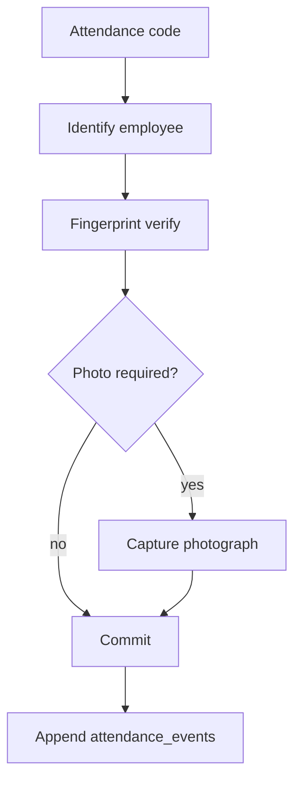

# Attendance workflow

## States and actions

Canonical states derived from the append-only ledger:

| State | Meaning |
| --- | --- |
| `off` | Not clocked in |
| `working` | Clocked in |
| `on_lunch` | On lunch break |

| Action | Typical transition |
| --- | --- |
| `clock_in` | `off` → `working` |
| `lunch_start` | `working` → `on_lunch` |
| `lunch_end` | `on_lunch` → `working` |
| `clock_out` | `working` → `off` |

Illegal transitions are rejected by the server. Timestamps use the **server clock** (UTC). Client-supplied `occurredAt` is ignored for commits.

## Terminal attempt sequence

API (device-signed):

1. `POST /api/v1/terminal/attempts`
2. `POST /api/v1/terminal/attempts/{id}/fingerprint`
3. `POST /api/v1/terminal/attempts/{id}/photo` when required
4. `POST /api/v1/terminal/attempts/{id}/commit`

Clock-in normally requires a photograph unless the tenant turns that policy off. Lunch and clock-out do not require a photo per product rules in [../README.md](../README.md).

## Corrections

Employees request corrections (`attendance.correction.request`). Managers decide assigned employees; HR can decide tenant-wide. Approval writes `attendance_adjustments` — it does **not** rewrite `attendance_events`. Dashboards and reports read both.

## Web vs terminal

| Channel | Auth |
| --- | --- |
| `/me`, `/hr`, … | Session cookie |
| `/kiosk` | Device enrollment + Ed25519 request signatures |

## Hardware status

Mock adapters in development; **unavailable** fingerprint/camera adapters in production until a vendor is integrated. See [devices-and-hardware.md](devices-and-hardware.md).
