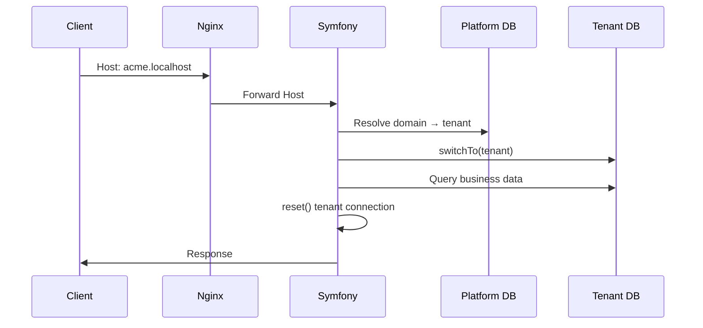

# Multi-tenancy

## Model

- **One platform database** for registry and operators.
- **One MySQL database per tenant** for business data.
- Tenant selection is from the HTTP **`Host`** header (and device binding for terminals), never from a client-supplied authoritative `tenant_id`.

## Request flow

## Lifecycle statuses

Tenants move through provisioning, active, suspended, and decommissioned states. Suspend/decommission block opening the database for normal traffic. Dropping the database requires decommission plus explicit confirmation.

Operational commands and HTTP equivalents: [../tenant-databases.md](../tenant-databases.md) and [../installation/database-setup.md](../installation/database-setup.md).

## Isolation guarantees (implemented)

- Per-request / per-message tenant switch with reset in `finally`
- Messenger only switches on trusted `TenantStamp` for received messages
- Persistent PDO disabled for tenant connections
- Production refuses SQLite tenant driver

## Quotas

Platform-owned limits: `max_users`, `max_employees`, `max_active_devices` (`NULL` = unlimited). Approaching threshold at 80%. Exceeding returns `409` with code `tenant_quota_exceeded`.
