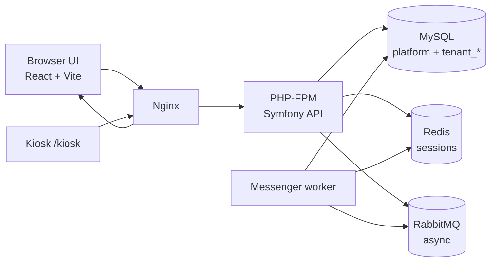

# System overview

## Purpose

Multi-tenant employee attendance SaaS: organizations (tenants) manage employees and attendance; platform operators manage tenants; physical or browser kiosks record clock events with server-side validation.

## High-level architecture

## Repository layout

| Path | Role |
| --- | --- |
| `backend/` | Symfony 7.4 API |
| `frontend/` | React client |
| `docker/` | PHP, Nginx, MySQL scripts, deploy |
| `docs/` | Documentation |
| `docker-compose.yml` | Development |
| `docker-compose.prod.yml` | Staging/production |

## Runtime (development)

Nginx on host port **8080** proxies `/api/` to PHP-FPM and the UI to the Vite container. MySQL, Redis, and RabbitMQ run as Compose services.

## Runtime (production)

PHP and Nginx images built from `docker/php/Dockerfile.prod` and `docker/nginx/Dockerfile`. Frontend is a static Vite build inside the Nginx image. Worker shares the PHP image. Secrets come from a private env file, not from image layers.

## Deeper reading

- Product map: [../README.md](../README.md)
- Design decisions: [../architecture.md](../architecture.md)
- Multi-tenancy: [multi-tenancy.md](multi-tenancy.md)
